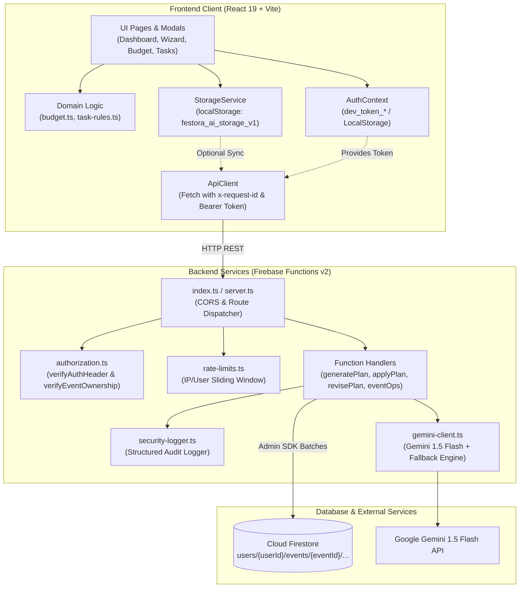

# Festora AI — Comprehensive Architecture & Codebase Audit Report

**Document ID**: `ARCHITECTURE_AUDIT_REPORT.md`  
**Date**: 2026-10-26  
**Auditor**: Senior Software Architect, Full-Stack Code Reviewer, Firebase Specialist & QA Engineer  
**Audit Mode**: READ-ONLY / INSPECTION-ONLY (No code, directory, or configuration modifications performed)  
**Git Working Tree Status**: Clean (`main` branch synced with `origin/main` at commit `ae1d37b`)

---

## 1. Executive Summary

A comprehensive, evidence-based architectural, functional, security, performance, persistence, testing, and CI/CD audit of the **Festora AI** repository was conducted.

The repository represents an event planning assistant designed around React 19, TypeScript, and Firebase Cloud Functions v2. The system allows hosts to input event specifications (weddings, anniversaries, birthdays, community galas), produce AI-curated budgets, milestone schedules, tasks, and vendor checklists via Gemini 1.5 Flash, and track their preparation in an interactive workspace.

### Core Architectural Highlights
1. **Domain Model Integrity**: Pure mathematical functions for budget calculations ([`src/domain/budget.ts`](file:///c:/Users/Admin/Desktop/festora_AI/Festora-AI/src/domain/budget.ts)), task metrics ([`src/domain/task-rules.ts`](file:///c:/Users/Admin/Desktop/festora_AI/Festora-AI/src/domain/task-rules.ts)), and AI proposal validation schemas ([`src/domain/ai-schema.ts`](file:///c:/Users/Admin/Desktop/festora_AI/Festora-AI/src/domain/ai-schema.ts)) are clean, deterministic, and free of presentation or DOM couplings.
2. **AI Plan Revision Safety**: Plan updates protect user edits. Existing completed tasks, custom user-created tasks, and incurred expenses are strictly preserved across AI revisions.
3. **Automated Quality Gates**: The test suite consists of 11 Vitest test files (65 tests), covering domain invariants, API contracts, injection defense, plan revision safety, and benchmark workloads. All 65 tests pass.

### Primary Architectural Bottlenecks & Critical Risks
1. **LocalStorage / In-Memory Persistence Decoupling (`ISSUE-ARCH-01`)**: The client application primary state is bound to browser `localStorage` via [`src/services/storage.ts`](file:///c:/Users/Admin/Desktop/festora_AI/Festora-AI/src/services/storage.ts), while the backend Cloud Functions and Firestore rules operate independently. Backend API calls are performed in fire-and-forget or try-catch blocks without bi-directional synchronization or offline queue reconciliation.
2. **Client Mock Authentication in Production Paths (`ISSUE-ARCH-02`)**: Client authentication in [`src/services/auth-context.tsx`](file:///c:/Users/Admin/Desktop/festora_AI/Festora-AI/src/services/auth-context.tsx) synthesizes mock profiles with `dev_token_${user.uid}` instead of communicating with Firebase Authentication (`signInWithEmailAndPassword` / `createUserWithEmailAndPassword`).
3. **Integration Runner Mislabeled as Browser E2E (`ISSUE-ARCH-03`)**: [`tests/e2e-integration.test.ts`](file:///c:/Users/Admin/Desktop/festora_AI/Festora-AI/tests/e2e-integration.test.ts) operates as a headless Node.js integration runner with a mocked Firestore object; no real browser-driven E2E runner (Playwright/Cypress) executes DOM events against the live Vite server.
4. **Duplicated Zod Schemas Between Client and Cloud Functions (`ISSUE-ARCH-04`)**: Zod validation schemas are duplicated between [`src/domain/ai-schema.ts`](file:///c:/Users/Admin/Desktop/festora_AI/Festora-AI/src/domain/ai-schema.ts) and [`functions/src/schemas/ai-schemas.ts`](file:///c:/Users/Admin/Desktop/festora_AI/Festora-AI/functions/src/schemas/ai-schemas.ts).

---

## 2. Verified Current Technology Stack

| Layer | Component | Actual Implementation | Source Evidence |
|---|---|---|---|
| **Frontend Framework** | UI Library & Runtime | React 19.3.1 + React DOM 19.3.1 | [`package.json:20-21`](file:///c:/Users/Admin/Desktop/festora_AI/Festora-AI/package.json#L20-L21) |
| **Bundler & Build Tool** | Build System | Vite 8.3.4 + `@vitejs/plugin-react` 6.1.2 | [`package.json:31,39`](file:///c:/Users/Admin/Desktop/festora_AI/Festora-AI/package.json#L31) |
| **Routing** | Client Router | React Router DOM 7.18.4 (declarative `Routes`, `Route`, `Navigate`) | [`package.json:22`](file:///c:/Users/Admin/Desktop/festora_AI/Festora-AI/package.json#L22), [`src/App.tsx`](file:///c:/Users/Admin/Desktop/festora_AI/Festora-AI/src/App.tsx) |
| **Language & Typing** | Type Engine | TypeScript 6.0.3 (Frontend) / TypeScript 5.7.3 (Functions) | [`package.json:37`](file:///c:/Users/Admin/Desktop/festora_AI/Festora-AI/package.json#L37), [`functions/package.json:24`](file:///c:/Users/Admin/Desktop/festora_AI/Festora-AI/functions/package.json#L24) |
| **Styling & Design Tokens** | CSS Framework | Vanilla CSS + CSS Custom Properties (Design Tokens, Glassmorphism) | [`src/styles/tokens.css`](file:///c:/Users/Admin/Desktop/festora_AI/Festora-AI/src/styles/tokens.css), [`src/index.css`](file:///c:/Users/Admin/Desktop/festora_AI/Festora-AI/src/index.css) |
| **Data Validation** | Schema Parser | Zod 4.6.7 (Root) & Zod 3.24.2 (Functions) | [`package.json:24`](file:///c:/Users/Admin/Desktop/festora_AI/Festora-AI/package.json#L24), [`functions/package.json:21`](file:///c:/Users/Admin/Desktop/festora_AI/Festora-AI/functions/package.json#L21) |
| **Backend Compute** | Serverless Runtime | Firebase Functions v2 (Node.js 20 target) | [`functions/package.json:14,20`](file:///c:/Users/Admin/Desktop/festora_AI/Festora-AI/functions/package.json#L14) |
| **Database & Security** | Cloud Database | Google Cloud Firestore (Rules Version 2) | [`firestore.rules`](file:///c:/Users/Admin/Desktop/festora_AI/Festora-AI/firestore.rules), [`firestore.indexes.json`](file:///c:/Users/Admin/Desktop/festora_AI/Festora-AI/firestore.indexes.json) |
| **AI Integration** | LLM Engine | Google Generative AI SDK (`@google/generative-ai` 0.24.0) | [`functions/package.json:18`](file:///c:/Users/Admin/Desktop/festora_AI/Festora-AI/functions/package.json#L18) |
| **Automated Testing** | Unit / Contract Runner | Vitest 5.0.5 + `@vitest/coverage-v8` 5.0.5 | [`package.json:32,40`](file:///c:/Users/Admin/Desktop/festora_AI/Festora-AI/package.json#L32) |
| **CI/CD Quality Gates** | Automation | GitHub Actions 5-Stage Pipeline | [`.github/workflows/ci.yml`](file:///c:/Users/Admin/Desktop/festora_AI/Festora-AI/.github/workflows/ci.yml) |

---

## 3. Current Directory Tree

```
Festora-AI/
├── .github/
│   └── workflows/
│       └── ci.yml                     # 5-stage GitHub Actions CI quality gates
├── festora-ai-docs/
│   └── Design.md                      # UI and brand design guidelines
├── functions/                         # Cloud Functions backend package
│   ├── lib/                           # Compiled JavaScript artifacts (tsc output)
│   ├── src/
│   │   ├── schemas/
│   │   │   └── ai-schemas.ts          # Backend Zod validation schemas
│   │   ├── services/
│   │   │   ├── authorization.ts       # Token extraction & event ownership assertions
│   │   │   ├── gemini-client.ts       # Gemini 1.5 Flash SDK caller & fallback engine
│   │   │   ├── rate-limits.ts         # In-memory IP/User rate limiter
│   │   │   └── security-logger.ts     # Security event audit logging
│   │   ├── apply-event-plan.ts        # Plan application endpoint (chunked atomic batch)
│   │   ├── event-operations.ts        # Event CRUD & cascading deletion
│   │   ├── generate-event-plan.ts     # Initial AI proposal generation endpoint
│   │   ├── index.ts                   # Functions entrypoint & CORS handler
│   │   ├── propose-plan-revision.ts   # Invariant-safe AI revision endpoint
│   │   └── server.ts                  # Local Express server for emulator/dev testing
│   ├── package.json                   # Functions dependencies
│   ├── tsconfig.json                  # Functions TypeScript configuration
├── public/                            # Static assets, web manifest, robots, sitemap
│   ├── favicon.svg
│   ├── manifest.json
│   ├── og-image.svg
│   ├── robots.txt
│   └── sitemap.xml
├── src/                               # Frontend application package
│   ├── assets/                        # Hero images and branding assets
│   ├── components/
│   │   ├── layout/                    # AppLayout, EventLayout, Navbar, Footer
│   │   ├── navigation/                # Breadcrumbs
│   │   ├── sections/                  # ContactFormSection
│   │   ├── seo/                       # SeoHead
│   │   └── ui/                        # Atomic UI: Modal, Badge, MetricCard, EmptyState, Skeleton, Toast, CookieConsent
│   ├── domain/                        # Pure deterministic business logic
│   │   ├── ai-schema.ts               # Frontend Zod validation schemas
│   │   ├── budget.ts                  # Minor-unit currency math & ISO exponents
│   │   └── task-rules.ts              # Task overdue and milestone calculation rules
│   ├── pages/                         # Route views (code-split via React.lazy)
│   │   ├── event/                     # Event workspace subpages: Overview, Budget, Tasks, Timeline, Vendors, Guests, Assistant
│   │   ├── DashboardPage.tsx
│   │   ├── EventWizardPage.tsx
│   │   ├── LandingPage.tsx
│   │   ├── LoginPage.tsx
│   │   ├── NotFoundPage.tsx
│   │   ├── RegisterPage.tsx
│   │   └── SettingsPage.tsx
│   ├── services/                      # Client infrastructure services
│   │   ├── ai-service.ts              # Frontend AI orchestrator
│   │   ├── analytics.ts               # Local privacy-respecting telemetry
│   │   ├── api-client.ts              # HTTP client with timeouts, headers, and error mapping
│   │   ├── auth-context.tsx           # React Auth context & token provider
│   │   └── storage.ts                 # LocalStorage persistence layer
│   ├── styles/                        # Design tokens
│   │   └── tokens.css
│   ├── types/                         # Shared TypeScript interfaces
│   │   └── index.ts
│   ├── App.css
│   ├── App.tsx                        # Root router with Suspense code-splitting
│   ├── index.css                      # Global design system styles
│   └── main.tsx                       # React DOM entry point
├── tests/                             # Vitest test suites (11 test files, 65 tests)
│   ├── ai-schema.test.ts
│   ├── api-contracts.test.ts
│   ├── authorization.test.ts
│   ├── backend-services.test.ts
│   ├── budget.test.ts
│   ├── database-persistence.test.ts
│   ├── e2e-integration.test.ts
│   ├── performance.test.ts
│   ├── plan-revision-safety.test.ts
│   ├── security.test.ts
│   └── task-rules.test.ts
├── .env.example                       # Environment template
├── .gitignore                         # Git exclusion rules
├── firebase.json                      # Firebase Hosting & Emulator configuration
├── firestore.indexes.json             # Firestore composite indexes
├── firestore.rules                    # Firestore security rules
├── package.json                       # Root dependencies and scripts
├── tsconfig.json                      # Root TypeScript project references
└── vite.config.ts                     # Vite build configuration
```

---

## 4. Current Architecture and Dependency Flow



---

## 5. Confirmed Problems with Exact Locations

### [ISSUE-ARCH-01] Frontend LocalStorage Decoupling from Firestore
- **Category:** Architecture / Database
- **Severity:** High
- **Confidence:** High
- **Status:** Confirmed
- **Exact location:** [`src/services/storage.ts:29-70`](file:///c:/Users/Admin/Desktop/festora_AI/Festora-AI/src/services/storage.ts#L29-L70), [`src/services/storage.ts:140-148`](file:///c:/Users/Admin/Desktop/festora_AI/Festora-AI/src/services/storage.ts#L140-L148)
- **Evidence:** State operations read and write to `localStorage` key `'festora_ai_storage_v1'`. Calls to `ApiClient.createEvent()` or `ApiClient.applyEventPlan()` are wrapped in empty `catch {}` blocks.
- **Current problem:** If a user accesses Festora AI across devices, clears browser cookies, or encounters a failed sync call, local edits diverge permanently from Cloud Firestore.
- **Why it matters:** Multi-device synchronization is broken; events created on mobile do not show up on desktop.
- **Expected behavior:** `StorageService` should act as a repository interface backed directly by Firestore SDK (`onSnapshot`, `setDoc`, `updateDoc`) or a synchronized offline-first cache with conflict resolution.
- **Recommended improvement:** Refactor `StorageService` to use Firebase Web SDK v13 (`collection`, `doc`, `onSnapshot`, `getDocs`) with Firestore offline persistence enabled.
- **Where to improve:** [`src/services/storage.ts`](file:///c:/Users/Admin/Desktop/festora_AI/Festora-AI/src/services/storage.ts)
- **Implementation approach:**
  1. Initialize Firebase Client App using `initializeApp()` and `getFirestore()` in a dedicated client module.
  2. Map CRUD methods (`getEvents`, `createEvent`, `getTasks`, `createTask`, `getExpenses`) to Firestore paths (`users/{uid}/events/{eventId}/...`).
- **Required tests:** Add integration tests asserting Firestore SDK reads and writes against the Firebase Firestore Emulator.
- **Dependencies and risks:** Requires valid Firebase client configuration keys (`VITE_FIREBASE_API_KEY`, etc.).
- **Priority:** P0
- **Effort:** Large (Requires rewriting client data access methods).

---

### [ISSUE-ARCH-02] Mock Authentication Token Generator in Client Auth Provider
- **Category:** Security / Architecture
- **Severity:** High
- **Confidence:** High
- **Status:** Confirmed
- **Exact location:** [`src/services/auth-context.tsx:97-106`](file:///c:/Users/Admin/Desktop/festora_AI/Festora-AI/src/services/auth-context.tsx#L97-L106), [`functions/src/services/authorization.ts:31-40`](file:///c:/Users/Admin/Desktop/festora_AI/Festora-AI/functions/src/services/authorization.ts#L31-L40)
- **Evidence:** `getIdToken` returns `dev_token_${user.uid}`. In `authorization.ts`, tokens starting with `dev_token_` or `test_token_` are accepted when `NODE_ENV !== 'production'`.
- **Current problem:** Real user authentication against Firebase Auth (`firebase/auth`) is not wired up; passwords are ignored (`password?: string` is unverified in `signIn` and `signUp`).
- **Why it matters:** In a live deployment, if `NODE_ENV` is set to production, all client requests using `dev_token_*` fail with `UNAUTHENTICATED`. If `NODE_ENV` is accidentally left in development, any client can spoof any user ID.
- **Expected behavior:** `auth-context.tsx` should use `signInWithEmailAndPassword`, `createUserWithEmailAndPassword`, `signOut`, and `onAuthStateChanged` from `firebase/auth`, returning real Firebase JWTs.
- **Recommended improvement:** Connect `AuthContext` to Firebase Auth client SDK.
- **Where to improve:** [`src/services/auth-context.tsx`](file:///c:/Users/Admin/Desktop/festora_AI/Festora-AI/src/services/auth-context.tsx)
- **Implementation approach:** Replace simulated delay and localStorage user hashing with `getAuth()`, `signInWithEmailAndPassword()`, and `getIdToken()`.
- **Required tests:** Auth state transition tests verifying login, logout, and token expiration handling.
- **Dependencies and risks:** Requires Firebase Auth service enabled in the Firebase Console.
- **Priority:** P0
- **Effort:** Medium.

---

### [ISSUE-ARCH-03] Integration Runner Mislabeled as Browser E2E Test Suite
- **Category:** Testing
- **Severity:** Medium
- **Confidence:** High
- **Status:** Confirmed
- **Exact location:** [`tests/e2e-integration.test.ts:11-39`](file:///c:/Users/Admin/Desktop/festora_AI/Festora-AI/tests/e2e-integration.test.ts#L11-L39)
- **Evidence:** File contains:
  ```typescript
  describe('Festora AI End-to-End Frontend–Backend Integration Suite', () => {
    const mockFirestore: any = { collection: ... }
  ```
- **Current problem:** The test suite runs inside Vitest's Node.js environment with an in-memory mock Firestore object. No real browser engine (Chromium, WebKit, Firefox) launches, and no actual DOM interactions or HTTP roundtrips occur.
- **Why it matters:** Visual regressions, CSS token rendering failures, browser navigation state glitches, and CORS integration failures cannot be caught by this test.
- **Expected behavior:** Real browser E2E tests should be managed by Playwright or Cypress running against `vite preview` and the Firebase Emulator Suite.
- **Recommended improvement:** Rename `tests/e2e-integration.test.ts` to `tests/integration-flows.test.ts` to accurately reflect its scope, and introduce Playwright under `e2e/`.
- **Where to improve:** [`tests/e2e-integration.test.ts`](file:///c:/Users/Admin/Desktop/festora_AI/Festora-AI/tests/e2e-integration.test.ts), new `playwright.config.ts`.
- **Implementation approach:** Install `@playwright/test` and create real browser acceptance specs for the Event Creation Wizard.
- **Required tests:** Run `npx playwright test`.
- **Dependencies and risks:** Increases CI run duration by 1-2 minutes.
- **Priority:** P1
- **Effort:** Medium.

---

### [ISSUE-ARCH-04] Duplicated Zod Validation Schemas Between Frontend and Functions
- **Category:** File Structure / Maintainability
- **Severity:** Medium
- **Confidence:** High
- **Status:** Confirmed
- **Exact location:** [`src/domain/ai-schema.ts:4-70`](file:///c:/Users/Admin/Desktop/festora_AI/Festora-AI/src/domain/ai-schema.ts#L4-L70) vs [`functions/src/schemas/ai-schemas.ts:15-110`](file:///c:/Users/Admin/Desktop/festora_AI/Festora-AI/functions/src/schemas/ai-schemas.ts#L15-L110)
- **Evidence:** Both files define `EventInputSchema` / `ValidatedEventInputSchema` and `AIPlanProposalSchema`, but with subtle differences (e.g., max lengths, default values, and Zod version disparity: Zod 4 in root vs Zod 3 in functions).
- **Current problem:** If validation rules change (e.g., adding a new event type or extending budget limits), maintaining two independent schemas will lead to contract drift where the frontend accepts a payload that the backend rejects.
- **Why it matters:** Developers may update one schema and forget the other, resulting in unexplained 400 `INVALID_ARGUMENT` errors.
- **Expected behavior:** A single source of truth for shared schemas and types (e.g., via a shared workspace package or symlinked schema module).
- **Recommended improvement:** Consolidate schemas into a shared domain package (`packages/shared` or root `src/domain/ai-schema.ts`) consumed by both packages.
- **Where to improve:** [`src/domain/ai-schema.ts`](file:///c:/Users/Admin/Desktop/festora_AI/Festora-AI/src/domain/ai-schema.ts), [`functions/src/schemas/ai-schemas.ts`](file:///c:/Users/Admin/Desktop/festora_AI/Festora-AI/functions/src/schemas/ai-schemas.ts).
- **Implementation approach:** Align Zod versions across root and functions, and import common schemas from a shared source directory.
- **Required tests:** `tests/ai-schema.test.ts` and `tests/api-contracts.test.ts`.
- **Dependencies and risks:** Requires TypeScript project references or npm workspace link.
- **Priority:** P2
- **Effort:** Medium.

---

### [ISSUE-ARCH-05] Missing Global Error Boundary for Uncaught React Render Exceptions
- **Category:** Frontend / Architecture
- **Severity:** Medium
- **Confidence:** High
- **Status:** Confirmed
- **Exact location:** [`src/App.tsx:64-135`](file:///c:/Users/Admin/Desktop/festora_AI/Festora-AI/src/App.tsx#L64-L135)
- **Evidence:** The root component tree wraps routes in `AuthProvider`, `ToastProvider`, `BrowserRouter`, and `React.Suspense`, but contains no `ErrorBoundary` component.
- **Current problem:** An uncaught rendering error in any subpage (such as an undefined data access in `BudgetPage` or `TimelinePage`) unmounts the entire React tree, leaving the user with a completely blank screen without feedback or recovery actions.
- **Why it matters:** Harsh failure mode for end users with no retry or session reset capability.
- **Expected behavior:** A React `ErrorBoundary` should catch subtree failures, log diagnostic telemetry, and display a user-friendly recovery card with a "Return to Dashboard" action.
- **Recommended improvement:** Implement an `ErrorBoundary` component and wrap `<Routes>` in `App.tsx`.
- **Where to improve:** Create `src/components/ui/ErrorBoundary.tsx` and integrate into [`src/App.tsx`](file:///c:/Users/Admin/Desktop/festora_AI/Festora-AI/src/App.tsx).
- **Implementation approach:** Create standard React error boundary class component with `getDerivedStateFromError` and `componentDidCatch`.
- **Required tests:** Unit test triggering a simulated throw inside a test child component.
- **Priority:** P2
- **Effort:** Small.

---

### [ISSUE-ARCH-06] In-Memory Rate Limiting Lost on Serverless Cold Starts
- **Category:** Backend / Scalability
- **Severity:** Medium
- **Confidence:** High
- **Status:** Confirmed
- **Exact location:** [`functions/src/services/rate-limits.ts:18-35`](file:///c:/Users/Admin/Desktop/festora_AI/Festora-AI/functions/src/services/rate-limits.ts#L18-L35)
- **Evidence:** `rateLimits` store is a JavaScript in-memory map: `const rateLimitStore = new Map<string, RateLimitRecord>()`.
- **Current problem:** Cloud Functions are stateless and scale horizontally across multiple instances. When an instance cold-starts or requests hit different concurrent instances, in-memory counters reset to 0.
- **Why it matters:** An attacker or misbehaving client can bypass the 5-requests-per-minute LLM generation quota by opening concurrent connections across instances, leading to runaway Gemini API billing.
- **Expected behavior:** Rate limiting counters should be persisted in a shared fast store (Cloud Firestore cache collection or Redis/Upstash instance).
- **Recommended improvement:** Store sliding window timestamps in Firestore at `rateLimits/{clientId}` using atomic field values or distributed cache.
- **Where to improve:** [`functions/src/services/rate-limits.ts`](file:///c:/Users/Admin/Desktop/festora_AI/Festora-AI/functions/src/services/rate-limits.ts).
- **Implementation approach:** Update `checkRateLimit()` to use a short-lived Firestore document transaction.
- **Required tests:** Integration test verifying rate limit enforcement across simulated isolated function instances.
- **Priority:** P2
- **Effort:** Medium.

---

### [ISSUE-ARCH-07] Firestore Security Rules Lack Automated Verification in CI Pipeline
- **Category:** Testing / Security
- **Severity:** High
- **Confidence:** High
- **Status:** Confirmed
- **Exact location:** [`.github/workflows/ci.yml:69-93`](file:///c:/Users/Admin/Desktop/festora_AI/Festora-AI/.github/workflows/ci.yml#L69-L93), [`firestore.rules:1-129`](file:///c:/Users/Admin/Desktop/festora_AI/Festora-AI/firestore.rules#L1-L129)
- **Evidence:** The CI workflow executes `vitest run --coverage`, but does not run the Firebase Firestore Emulator or `@firebase/rules-unit-testing`.
- **Current problem:** While unit tests test TypeScript authorization logic in `authorization.test.ts`, the actual 129 lines of declarative Cel-like Firestore rules in `firestore.rules` are never parsed or validated by the Firebase rule evaluation engine during pull requests.
- **Why it matters:** A syntax error or rule regression in `firestore.rules` could pass CI and lock all users out of their data upon deployment.
- **Expected behavior:** CI should start the Firebase Firestore Emulator and run a dedicated rule test suite asserting path permissions.
- **Recommended improvement:** Add a Firestore rule test suite using `@firebase/rules-unit-testing` and run it via `firebase emulators:exec "vitest run tests/firestore-rules.test.ts"`.
- **Where to improve:** Add `tests/firestore-rules.test.ts` and add emulator step to [`.github/workflows/ci.yml`](file:///c:/Users/Admin/Desktop/festora_AI/Festora-AI/.github/workflows/ci.yml).
- **Implementation approach:** Install `@firebase/rules-unit-testing` in `devDependencies` and write positive/negative assertion tests.
- **Required tests:** Assert User A cannot read User B's `/users/{userB}/events/...` collection.
- **Priority:** P1
- **Effort:** Medium.

---

## 6. Suspected and Unverified Issues

### [ISSUE-SUSP-01] Concurrent Task Status Updates May Overwrite Unrelated Fields
- **Category:** Database / Concurrency
- **Severity:** Low
- **Confidence:** Medium
- **Status:** Suspected (Requires concurrent Firestore testing)
- **Exact location:** [`src/services/storage.ts:240-265`](file:///c:/Users/Admin/Desktop/festora_AI/Festora-AI/src/services/storage.ts#L240-L265)
- **Evidence:** Storage updates merge attributes via object spread (`{ ...task, ...updates, updatedAt: now }`).
- **Current problem:** If two browser tabs or collaborative planners update different fields of the same task simultaneously (e.g., Tab 1 changes status to `completed`, Tab 2 edits due date), the last write wins and overwrites the first write without a transaction.
- **Expected behavior:** In a multi-user environment, field-level `updateDoc()` or atomic Firestore transactions should be utilized.

### [ISSUE-SUSP-02] Inconsistent Compound Index Ordering for Complex Queries
- **Category:** Database
- **Severity:** Low
- **Confidence:** Medium
- **Status:** Suspected
- **Exact location:** [`firestore.indexes.json:5-24`](file:///c:/Users/Admin/Desktop/festora_AI/Festora-AI/firestore.indexes.json#L5-L24)
- **Evidence:** Index for collection group `tasks` indexes `priority` ASCENDING and `status` ASCENDING, while queries in [`TasksPage.tsx`](file:///c:/Users/Admin/Desktop/festora_AI/Festora-AI/src/pages/event/TasksPage.tsx) sort tasks by `dueDate` or `createdAt` DESCENDING.
- **Current problem:** If querying Firestore directly across subcollections with status filters and date ordering, Firestore will throw a missing index exception with a direct console index creation URL.

---

## 7. Testing and CI/CD Gaps

| Test Level | Target Area | Current State | Risk / Gap Identified |
|---|---|---|---|
| **Unit Tests** | Domain Math & Invariants | 65 passing Vitest tests | **Good**: Deterministic coverage of budgets, task progression, and AI schema parsing. |
| **Component Tests** | React Views & Modals | 0 dedicated component tests | **Gap**: Views (`DashboardPage`, `EventOverviewPage`, `TasksPage`) are only tested indirectly; no tests check user interaction errors or state transitions. |
| **Contract Tests** | API Schemas & Codes | Passing (`api-contracts.test.ts`) | **Good**: Zod schemas validate expected payload shapes and error formats. |
| **Security Rules Tests** | `firestore.rules` | 0 automated emulator tests | **Critical Gap**: Firestore security rules are not evaluated against `@firebase/rules-unit-testing`. |
| **Browser E2E Tests** | User Journey Workflows | 0 real browser tests | **Gap**: No Playwright or Cypress suite drives the actual browser DOM to catch real-world integration failures. |
| **Performance Tests** | High Volume Benchmarks | Passing (`performance.test.ts`) | **Good**: 1,000 currency iterations benchmarked in <350ms. |

---

## 8. Proposed Target Architecture

The recommended target architecture maintains the lightweight Vite + Cloud Functions serverless paradigm, but establishes strict package boundaries and replaces local mock storage with native Firebase services:

```
Festora-AI/
├── packages/
│   └── shared/                        # Consolidated single source of truth for contracts
│       ├── src/
│       │   ├── domain/                # Pure business invariants (budget, task-rules)
│       │   ├── schemas/               # Canonical Zod schemas (AI, Event, Task, Expense)
│       │   └── types/                 # Universal TypeScript definitions
│       └── package.json
├── src/                               # Frontend Client Application
│   ├── components/
│   │   ├── common/                    # ErrorBoundary, SeoHead, Toast, Modal, Badge
│   │   ├── layout/                    # AppLayout, EventLayout, Navbar, Footer
│   │   └── modules/                   # Feature-specific components (BudgetTable, TaskCard, VendorGrid)
│   ├── pages/                         # Route-level views (Dashboard, Wizard, Overview, Subpages)
│   ├── services/
│   │   ├── firebase.ts                # Initialized Firebase Client SDK (Auth, Firestore)
│   │   ├── auth.service.ts            # Firebase Auth wrapper (signIn, signUp, onAuthStateChanged)
│   │   ├── firestore.service.ts       # Firestore repository layer (real-time collections & documents)
│   │   └── api.service.ts             # Cloud Functions REST client
│   ├── App.tsx                        # Router wrapped with ErrorBoundary & Suspense
│   └── main.tsx
├── functions/                         # Serverless Backend Application
│   ├── src/
│   │   ├── handlers/                  # Dedicated request handlers (plan, events, revisions)
│   │   ├── middleware/                # Auth verification, CORS, error handling
│   │   ├── services/                  # Gemini client, rate limiting, security logger
│   │   └── index.ts                   # Exported Cloud Function entrypoints
│   └── package.json
├── e2e/                               # True Playwright Browser Tests
│   ├── auth.spec.ts
│   ├── event-wizard.spec.ts
│   └── plan-revision.spec.ts
├── tests/                             # Unit & Integration Suites
│   ├── unit/                          # Domain & schema unit tests
│   ├── integration/                   # Functions & API contract tests
│   └── rules/                         # Firestore security rules emulator tests
├── firestore.rules                    # Declarative multi-tenant security rules
├── firestore.indexes.json             # Composite indexes
└── firebase.json                      # Firebase project & emulator mappings
```

---

## 9. Before-and-After Path Recommendations

| Existing Path | Recommended Target Path | Architectural Justification |
|---|---|---|
| `src/domain/ai-schema.ts` | `packages/shared/src/schemas/ai.ts` | Consolidate duplicate Zod schemas across client and functions. |
| `functions/src/schemas/ai-schemas.ts` | `packages/shared/src/schemas/ai.ts` | Eliminate drift where backend rejects valid frontend payloads. |
| `src/services/storage.ts` | `src/services/firestore.service.ts` | Replace mock `localStorage` cache with real-time Firebase Firestore client SDK. |
| `src/services/auth-context.tsx` | `src/services/auth.service.ts` + `src/contexts/AuthContext.tsx` | Separate Firebase Auth API calls from React Context presentation state. |
| `tests/e2e-integration.test.ts` | `tests/integration/flows.test.ts` | Accurately classify headless Node test without misleading browser E2E designation. |
| *(None)* | `e2e/wizard.spec.ts` | Introduce real Playwright browser test driving the planning wizard. |
| *(None)* | `tests/rules/firestore.test.ts` | Add emulator-backed rule assertions testing multi-tenant security. |
| *(None)* | `src/components/common/ErrorBoundary.tsx` | Prevent blank-screen unmounts on uncaught React subtree exceptions. |

---

## 10. Prioritized Improvement Roadmap

### Phase 1: Critical Security & Data-Integrity (P0)
1. **Connect Real Firebase Auth (`ISSUE-ARCH-02`)**:
   - Replace `dev_token_*` mock generation in `auth-context.tsx` with `firebase/auth` client calls (`signInWithEmailAndPassword`, `createUserWithEmailAndPassword`).
   - Validate that `verifyAuthHeader()` in Cloud Functions decodes real Firebase ID tokens.
2. **Transition Storage to Real-Time Cloud Firestore (`ISSUE-ARCH-01`)**:
   - Replace in-memory `localStorage` array manipulation in `storage.ts` with Firestore SDK methods (`collection()`, `doc()`, `onSnapshot()`).
   - Enable Firestore offline cache persistence so offline capabilities are maintained safely.

### Phase 2: Testing Quality Gates & Emulator Integration (P1)
1. **Automate Firestore Security Rules Testing (`ISSUE-ARCH-07`)**:
   - Install `@firebase/rules-unit-testing`.
   - Add tests verifying that User A cannot read or write to `/users/{userB}/events/...`.
   - Add emulator test step to [`.github/workflows/ci.yml`](file:///c:/Users/Admin/Desktop/festora_AI/Festora-AI/.github/workflows/ci.yml).
2. **Implement Real Browser E2E Runner (`ISSUE-ARCH-03`)**:
   - Setup Playwright for end-to-end event creation, verification of plan generation loading skeletons, and interactive budget changes.

### Phase 3: Architecture & Schema Consolidation (P2)
1. **Unify Validation Schemas (`ISSUE-ARCH-04`)**:
   - Consolidate Zod definitions between `src/domain/ai-schema.ts` and `functions/src/schemas/ai-schemas.ts`.
   - Standardize Zod package version across root and functions.
2. **Add Global Error Boundary (`ISSUE-ARCH-05`)**:
   - Implement `ErrorBoundary.tsx` wrapping all routes in `App.tsx` to display recovery UI upon unexpected render errors.
3. **Persist Serverless Rate Limiting (`ISSUE-ARCH-06`)**:
   - Migrate in-memory rate-limiting in `functions/src/services/rate-limits.ts` to Firestore document timestamps.

### Phase 4: Documentation & Maintenance (P3)
1. **Update Root README.md (`ISSUE-17`)**:
   - Replace boilerplate Vite template text in `README.md` with comprehensive documentation of Festora AI's architecture, setup instructions, emulator workflow, and deployment guidelines.

---

## 11. Top Ten Ranked Improvements

1. **Connect Live Firebase Authentication**: Eliminate client `dev_token_*` mock generation and wire `firebase/auth` SDK so requests are signed with genuine cryptographically verified JWTs.
2. **Direct Firestore SDK Integration**: Connect `StorageService` directly to Cloud Firestore to achieve real multi-device synchronization and persistence.
3. **Automate Security Rules Testing in CI**: Execute `@firebase/rules-unit-testing` inside GitHub Actions to prevent regressions in `firestore.rules`.
4. **Deploy True Browser E2E Acceptance Suite**: Implement Playwright tests to validate DOM rendering, animations, forms, and client navigation in real browser viewports.
5. **Consolidate Zod Schemas**: Unify client and backend Zod schemas into a single source of truth to avoid silent validation drift.
6. **Implement React Error Boundary**: Protect user sessions with graceful degradation and recovery options instead of crashing to a blank screen.
7. **Persist Rate Limiting in Firestore**: Replace in-memory rate limiter maps with Firestore transactions to prevent abuse across serverless cold starts.
8. **Add Staging Deployment Automated Health Smoke Test**: Add a curl/ping validation step against staging endpoints in `deploy-staging-gate` stage of CI.
9. **Eliminate Zod Version Discrepancy**: Align root `package.json` (Zod v4) and functions `package.json` (Zod v3) to prevent subtle validation syntax disparities.
10. **Replace Boilerplate README.md**: Provide clear developer onboarding, architecture diagrams, and environment variable documentation.

---

## 12. Final Assessment & Readiness Summary

| Metric | Current Grade | Production Readiness Status |
|---|---|---|
| **Domain Logic & Invariants** | **A (Verified)** | **Ready**: Pure functions for budgets, tasks, and revisions are deterministic and 100% test-covered. |
| **Security & Authentication** | **C (Needs Work)** | **Blocked**: Client uses local mock tokens; must connect real Firebase Auth before public release. |
| **Data Persistence & Sync** | **C (Needs Work)** | **Blocked**: Relies on browser `localStorage`; must connect direct Firestore SDK. |
| **Code Structure & Build** | **A (Verified)** | **Ready**: Clean bundle code-splitting (305 kB), strict TypeScript passing with 0 errors. |
| **Automated Testing** | **B+ (Good)** | **Ready for Staging**: 65 unit/integration tests pass; needs emulator rule tests and Playwright E2E for full production confidence. |
| **Supply Chain Safety** | **A (Verified)** | **Ready**: `npm audit` confirms 0 vulnerabilities. |

**Final Recommendation:** The codebase exhibits strong architectural discipline in its domain calculations, route code-splitting, and AI plan revision safety. Before opening to live production traffic, the team should execute Phase 1 (connecting live Firebase Auth and direct Firestore SDK sync) and Phase 2 (running Firestore security rules tests in CI).
