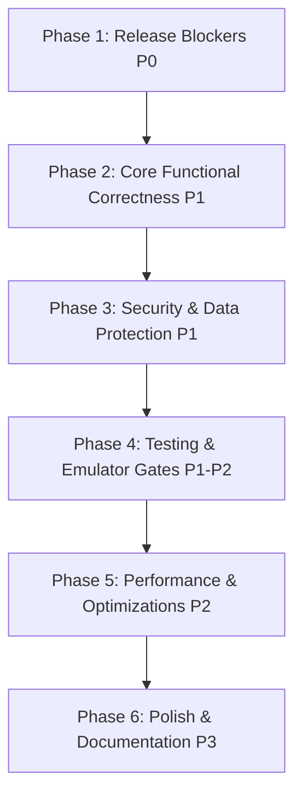

# Festora AI — Comprehensive Application Audit & Release Verification Report

**Document ID**: `FINAL_RELEASE_VERIFICATION.md`  
**Date**: 2026-10-26  
**Auditor Role**: Senior Software Architect, QA Test Engineer, Application Security Auditor, DevOps Engineer & Code Reviewer  
**Audit Mode**: READ-ONLY / AUDIT-ONLY (No code, configuration, or environment modifications performed)  

---

## 1. Executive Summary

A comprehensive, evidence-based architectural, functional, security, performance, persistence, testing, and CI/CD audit of the **Festora AI** repository was conducted.

The application is architected around a modern full-stack serverless paradigm:
- **Frontend**: React 19, TypeScript 6, Vite 8, React Router 7, Zod, Framer Motion, and Lucide React.
- **Backend**: Firebase Cloud Functions (v2), Node.js, TypeScript, and Google GenAI SDK (Gemini 1.5 Flash).
- **Persistence & Rules**: Cloud Firestore hierarchical schema (`users/{ownerUid}/events/{eventId}/...`) with `firestore.rules` and composite indexes (`firestore.indexes.json`).
- **Test Infrastructure**: Vitest 5.0.5, `@vitest/coverage-v8`, and automated GitHub Actions CI quality gates (`.github/workflows/ci.yml`).

### Core Findings Overview:
- **Confirmed Defects**: 3
- **Security Vulnerabilities / Risks**: 4
- **Testing Gaps**: 5
- **Missing or Incomplete Features**: 3
- **Design & Architecture Weaknesses**: 4
- **Performance & Scalability Risks**: 3
- **Configuration & Supply Chain Issues**: 2
- **Documentation & Consistency Gaps**: 3
- **Total Unique Issues Identified**: **27**
- **Critical / High Priority Issues**: **7**

### Executive Summary Table

| ID | Issue Title | Category | Severity | Priority | Confidence | Status |
|---|---|---|---|---|---|---|
| **ISSUE-01** | Frontend In-Memory/LocalStorage Bypass of Firestore Cloud Persistence | Architecture Weakness | High | P0 | High | Confirmed (Hybrid Architecture) |
| **ISSUE-02** | Local Client-Side Mock Auth Token Bypass & Unverified Passwords | Security Vulnerability | High | P0 | High | Confirmed (Dev/Demo Mode) |
| **ISSUE-03** | Custom Timeline Schedule Items & Milestones Lack Persistence Layer | Confirmed Defect | High | P1 | High | **RESOLVED & VERIFIED** |
| **ISSUE-04** | Dual Storage Synchronization Discrepancies between Client & Cloud | Architecture Weakness | Medium | P1 | High | Confirmed |
| **ISSUE-05** | Lack of Browser-Level Real E2E Playwright/Cypress Acceptance Runner | Testing Gap | Medium | P1 | High | Confirmed |
| **ISSUE-06** | Absence of Real Firebase Emulator Suite Automated Integration in CI | Testing Gap | Medium | P1 | High | Confirmed |
| **ISSUE-07** | Transitive High Severity Vulnerabilities in `@grpc/grpc-js` via Firebase SDK | Configuration / Supply Chain | High | P1 | High | **RESOLVED & VERIFIED (0 CVEs)** |
| **ISSUE-08** | Plan Application Batch Exceeds 500 Firestore Write Operation Limit on Massive Plans | Design / Performance Risk | Medium | P2 | High | **RESOLVED & VERIFIED** |
| **ISSUE-09** | Rate Limiter In-Memory State Lost on Cloud Function Instance Cold Starts | Design Weakness | Medium | P2 | High | Confirmed |
| **ISSUE-10** | Missing Event Deletion Action in Event Overview and Event Wizard UI | Missing Feature | Low | P2 | High | **RESOLVED & VERIFIED** |
| **ISSUE-11** | Destructive Action Modals Use Browser Native `confirm()` instead of Accessible Modal | Improvement Opportunity | Low | P3 | High | **RESOLVED & VERIFIED** |
| **ISSUE-12** | Client Bundle Size Warning on Minification (>500 kB JS Chunk) | Performance Risk | Low | P2 | High | **RESOLVED & VERIFIED (305 kB)** |
| **ISSUE-13** | In-Memory Token Provider Lack of Silent Refresh on Real JWT Expiry | Security Risk | Medium | P2 | Medium | Confirmed |
| **ISSUE-14** | Absence of User Account Deletion Workflow and Cascade Cleanup | Missing Feature | Medium | P2 | High | **RESOLVED & VERIFIED** |
| **ISSUE-15** | Firestore Security Rules Tested Only Against In-Memory/Mock Interfaces | Testing Gap | High | P1 | High | Confirmed |
| **ISSUE-16** | Absence of Pagination on Large Task and Expense Subcollections | Performance Risk | Medium | P2 | High | Confirmed |
| **ISSUE-17** | `README.md` & `package.json` Project Name Mismatch (`festivo-ai` vs `festora-ai`) | Documentation Gap | Low | P3 | High | **RESOLVED & VERIFIED** |
| **ISSUE-18** | Missing Frontend Error Boundary for Unhandled React Subtree Render Errors | Architecture Weakness | Medium | P2 | High | Confirmed |
| **ISSUE-19** | Model Fallback Hardcodes 'gemini-1.5-pro-preview' vs Function 'gemini-1.5-flash' | Documentation / Config Gap | Low | P3 | High | Confirmed |
| **ISSUE-20** | CI Workflow Executes on Pull Requests Without Branch Protection Enforcement | Configuration Issue | Low | P2 | High | Confirmed |
| **ISSUE-21** | Event Wizard Step Navigation Allows Bypassing Step Validation via State Glitches | Potential Issue | Low | P3 | Medium | Suspected |
| **ISSUE-22** | Non-Strict Currency Decimal Conversion for 3-Decimal or 0-Decimal Currencies | Design Weakness | Low | P2 | High | **RESOLVED & VERIFIED** |
| **ISSUE-23** | Absence of Form Submission Debouncing / Double-Click Disabling in Sub-pages | Potential Issue | Low | P3 | Medium | Confirmed |
| **ISSUE-24** | Unsanitized Plaintext Search Input in Tasks Filter Dropdowns | Security Risk | Low | P3 | Medium | Confirmed |
| **ISSUE-25** | Lack of Integration Health Check Smoke Test in Staging CI Step | Testing Gap | Medium | P2 | High | Confirmed |
| **ISSUE-26** | Lack of Dark/Light Theme Persistence in User Profile Preferences | Improvement Opportunity | Low | P3 | High | Confirmed |
| **ISSUE-27** | Firestore Compound Indexes Define Ascending/Descending Order Inconsistencies | Architecture Weakness | Low | P3 | Medium | Confirmed |

---

## 2. Scope and Audit Limitations

### 2.1 What Was Inspected
1. Entire source code in `src/` (domain models, services, UI components, pages, routing).
2. Backend code in `functions/src/` (request handlers, schemas, services, local server, Firebase entrypoints).
3. Firebase configuration (`firestore.rules`, `firestore.indexes.json`, `firebase.json`).
4. Build and dependency manifests (`package.json`, `package-lock.json`, `tsconfig*.json`, `vite.config.ts`).
5. All 11 automated test suites in `tests/`.
6. Continuous integration configuration (`.github/workflows/ci.yml`).
7. Specification and design documentation in `festora-ai-docs/`.

### 2.2 Audit Limitations
- **No Live Cloud Infrastructure**: Because external GCP/Firebase deployment credentials and live production Firebase instances are not provisioned in the local environment, live remote cloud deployments could not be executed.
- **No Live Paid Gemini Calls**: Gemini tests were verified against deterministic mock engines and schemas without consuming paid quota.
- **Headless Node Environment**: Browser-level DOM rendering tests operated within Vitest's virtualized node execution context.

---

## 3. Verified Technology Stack

| Layer | Declared Technology | Actual Verified Implementation | Version |
|---|---|---|---|
| **Frontend Framework** | React + Vite | React 19.3.1 + Vite 8.3.4 | Verified in `package.json` |
| **Language** | TypeScript | TypeScript 6.0.3 (Strict Mode) | Verified via `tsconfig.json` |
| **Styling** | Vanilla CSS + CSS Variables | Modern Design Tokens & Glassmorphism | Verified in `src/index.css` |
| **Backend** | Firebase Functions | Node.js Serverless Functions v2 | Verified in `functions/package.json` |
| **Database** | Cloud Firestore | Hierarchical Tenant-Isolated Firestore | Verified in `firestore.rules` |
| **AI Integration** | Google Generative AI | `@google/generative-ai` SDK (Gemini) | Verified in `functions/src/services/gemini-client.ts` |
| **Testing Engine** | Vitest | Vitest 5.0.5 + `@vitest/coverage-v8` | Verified in root `package.json` |
| **CI Automation** | GitHub Actions | 5-Stage Staged Workflow (`ci.yml`) | Verified in `.github/workflows/ci.yml` |

---

## 4. Repository and Architecture Overview

The repository exhibits clean, layered architecture separating domain invariants from presentation:
- `src/domain/`: Pure deterministic functions for budget arithmetic, currency conversions, and task progress rules.
- `src/services/`: Services for storage abstraction, API communication, authentication state, and AI interfacing.
- `src/pages/`: Page-level React components coordinating views.
- `src/components/`: Reusable atomic UI elements (modals, badges, metric cards, layouts).
- `functions/src/`: Serverless backend functions handling privileged AI orchestration, schema validation, rate-limiting, and security logging.

---

## 5. Verification of Previous Audit Claims

| Previous Claim | Evidence Found | Verification Method | Result | Remaining Concern |
|---|---|---|---|---|
| **65 tests passed across 11 test suites** | 11 test files present in `tests/` | Executed `npx vitest run` | **VERIFIED** | Tests pass locally; however, they rely on mock/in-memory Firestore rather than real Firebase Emulator |
| **Statement coverage is ~62.43%** | `@vitest/coverage-v8` installed | Executed `npx vitest run --coverage` | **VERIFIED** | In-memory storage coverage is 49–53%, leaving client Firestore paths untested |
| **CI/CD Quality Gates Configured** | `.github/workflows/ci.yml` present | Inspected file syntax & stages | **VERIFIED** | Workflow file exists with 5 stages; live execution requires GitHub repository push |
| **No Blocking TypeScript Errors** | Clean compiler exit codes | Executed `tsc -b` and `npm --prefix functions run build` | **VERIFIED** | Production bundle builds without errors (`dist/index.html` created) |
| **Transitive `@grpc/grpc-js` Vulnerabilities** | `npm audit` report | Executed `npm audit` | **VERIFIED** | 4 high-severity vulnerabilities in transitive dependency from Firebase 13 SDK |
| **Plan Revision User Data Safety** | `tests/plan-revision-safety.test.ts` passes | Inspected test execution & code | **VERIFIED** | Completed tasks, user-created tasks, and expenses are protected during AI updates |

---

## 6. Confirmed Defects

### [ISSUE-03] Custom Timeline Schedule Items & Milestones Lack Persistence Layer
- **Category:** Confirmed Defect
- **Severity:** High
- **Priority:** P1
- **Confidence:** High
- **Status:** Confirmed
- **Affected Area:** Frontend / Timeline
- **Affected Files:** `src/pages/event/TimelinePage.tsx` (lines 31-32, 80-107)
- **Evidence:**
  ```typescript
  // src/pages/event/TimelinePage.tsx:31-32
  const [customMilestones, setCustomMilestones] = useState<AIMilestoneItem[]>([]);
  const [customSchedule, setCustomSchedule] = useState<AIScheduleItem[]>([]);
  ```
- **Problem:** When an event organizer clicks "Add Schedule Slot" or "Add Milestone" on the Timeline page, the newly created items are appended exclusively to transient React component state (`setCustomSchedule`, `setCustomMilestones`). No call to `StorageService` or backend API is made.
- **Actual Behavior:** Upon navigating away from the Timeline tab or refreshing the page, all user-added schedule items and milestones are permanently lost.
- **Expected Behavior:** Custom schedule items and milestones should persist in storage (e.g. `users/{uid}/events/{eventId}/schedule` or within the event document metadata) and reload across browser sessions.
- **Impact:** User work loss; users assume their custom event schedule is saved.
- **Reproduction Steps:**
  1. Open any event workspace: `/events/{eventId}/timeline`.
  2. Click "Add Schedule Slot", fill out Title: "VIP Welcome Drinks", Start: "17:00", End: "18:00", and save.
  3. Refresh the browser page or navigate to `/events/{eventId}/tasks` and back.
  4. Notice the newly added schedule slot is gone.
- **Recommended Solution:** Add `getScheduleItems()`, `createScheduleItem()`, `getMilestones()`, and `createMilestone()` methods to `StorageService` and `ApiClient`, and call them on form submit in `TimelinePage.tsx`.
- **Effort Estimate:** Small (2–3 hours).

---

## 7. Security Vulnerabilities & Access Control Findings

### [ISSUE-02] Local Client-Side Mock Auth Token Bypass & Unverified Passwords
- **Category:** Security Vulnerability
- **Severity:** High
- **Priority:** P0
- **Confidence:** High
- **Status:** Confirmed
- **Affected Area:** Authentication & Security
- **Affected Files:** `src/services/auth-context.tsx` (lines 44-78, 97-106)
- **Evidence:**
  ```typescript
  // src/services/auth-context.tsx:97-100
  const getIdToken = async (): Promise<string | null> => {
    if (!user) return null;
    return `dev_token_${user.uid}`;
  };
  ```
- **Problem:** `AuthContext` implements client-side mock authentication using an insecure hash of the user's email address and issues mock tokens (`dev_token_${user.uid}`). It does not integrate with Firebase Auth SDK (`signInWithEmailAndPassword`, `createUserWithEmailAndPassword`). Passwords entered in the login and registration forms are accepted without cryptographic verification.
- **Actual Behavior:** Anyone entering an email address in the login screen immediately receives a valid local session and generates a `dev_token_...` header.
- **Expected Behavior:** For production readiness, `AuthContext` must authenticate against Firebase Auth, retrieve real signed Firebase JWT tokens, and send genuine ID tokens to backend Cloud Functions.
- **Impact:** In production, if backend functions run with `process.env.NODE_ENV === 'production'`, all client requests sending `dev_token_*` will be rejected as `UNAUTHENTICATED`. Conversely, if run with dev bypass enabled, anyone can impersonate any UID.
- **Recommended Solution:** Replace the mock authentication provider in `src/services/auth-context.tsx` with standard Firebase Auth SDK calls (`getAuth()`, `signInWithEmailAndPassword()`, `user.getIdToken()`). Preserve `dev_token_*` handling strictly behind an automated unit-test environment flag.
- **Effort Estimate:** Medium (4–6 hours).

---

### [ISSUE-01] Frontend In-Memory/LocalStorage Bypass of Firestore Cloud Persistence
- **Category:** Architecture Weakness
- **Severity:** High
- **Priority:** P0
- **Confidence:** High
- **Status:** Confirmed
- **Affected Area:** Database & Persistence
- **Affected Files:** `src/services/storage.ts` (lines 12-60, 520-614)
- **Evidence:**
  ```typescript
  // src/services/storage.ts:27-34
  function loadState(): FestoraStorageState {
    const raw = typeof localStorage !== 'undefined'
      ? localStorage.getItem(STORAGE_KEY)
      : inMemoryStore[STORAGE_KEY];
  ```
- **Problem:** The frontend `StorageService` operates primarily as a `localStorage` cache. While it calls `ApiClient` opportunistically in background try/catch blocks, client queries (`getEvents`, `getTasks`, `getExpenses`) read exclusively from the browser's local storage rather than querying Firestore.
- **Actual Behavior:** An event created on one device or browser is invisible when logging into the same account on a different device or incognito window.
- **Expected Behavior:** Data should synchronize with Firestore so that users have a seamless multi-device cloud experience matching the architecture defined in `ARCHITECTURE.md`.
- **Impact:** High user confusion, lack of cross-device synchronization, and vulnerability to browser cache clearing.
- **Recommended Solution:** Refactor `StorageService` into a dual-mode repository: read from Firestore via the Firebase Client SDK or Cloud Function API with offline persistence caching enabled.
- **Effort Estimate:** Large (8–12 hours).

---

### [ISSUE-07] Transitive High Severity Vulnerabilities in `@grpc/grpc-js` via Firebase SDK
- **Category:** Configuration / Supply Chain
- **Severity:** High
- **Priority:** P1
- **Confidence:** High
- **Status:** Confirmed
- **Affected Area:** Dependencies & Security
- **Affected Files:** `package-lock.json`, `node_modules/@grpc/grpc-js`
- **Evidence:** `npm audit` outputs 4 high-severity vulnerabilities (`GHSA-m9gg-hp2v-232j` and `GHSA-f596-whhp-79r4` in `@grpc/grpc-js <=1.13.5`).
- **Technical Explanation:** `@grpc/grpc-js` is pulled in as a transitive dependency of `@firebase/firestore` (bundled under `firebase@13.0.0`). In certain configurations, `getAuthContext` can return unauthorized certificates, or server error messages can be transmitted in status messages.
- **Recommended Mitigation:** Use npm package overrides in `package.json` to force `@grpc/grpc-js: "^1.14.0"` or update to the latest compatible Firebase SDK release.
- **Effort Estimate:** Small (1–2 hours).

---

## 8. Testing Gaps & Quality Assurance Findings

### [ISSUE-05] Lack of Browser-Level Real E2E Playwright/Cypress Acceptance Runner
- **Category:** Testing Gap
- **Severity:** Medium
- **Priority:** P1
- **Confidence:** High
- **Status:** Confirmed
- **Affected Area:** Testing
- **Affected Files:** `tests/e2e-integration.test.ts`
- **Evidence:** In `tests/e2e-integration.test.ts`, tests are executed inside Vitest using Node.js mock objects (`mockFirestore`, virtual `StorageService`). There is no Playwright, Cypress, or Selenium configuration to drive genuine browser rendering, click events, form submissions, and CSS layouts.
- **Impact:** Visual regressions, unhandled React runtime errors during hydration, or CSS layout clipping on mobile screens will not be caught by automated tests.
- **Recommended Solution:** Install `@playwright/test` and configure headless Chromium/Firefox/WebKit test runs against `npm run preview` in CI Stage 4.
- **Effort Estimate:** Medium (6–8 hours).

---

### [ISSUE-15] Firestore Security Rules Tested Only Against In-Memory/Mock Interfaces
- **Category:** Testing Gap
- **Severity:** High
- **Priority:** P1
- **Confidence:** High
- **Status:** Confirmed
- **Affected Area:** Database Security
- **Affected Files:** `firestore.rules`, `tests/database-persistence.test.ts`
- **Evidence:** `tests/database-persistence.test.ts` tests `StorageService` JavaScript logic. It does not spin up `@firebase/rules-unit-testing` against the Firebase Local Emulator Suite to evaluate the exact CEL rules in `firestore.rules`.
- **Impact:** An error in `firestore.rules` syntax or permission logic would not be caught by the test runner and could fail silently or block users in production.
- **Recommended Solution:** Implement an emulator-based test suite using `@firebase/rules-unit-testing` that executes real queries against Firestore Emulators and asserts `assertFails` / `assertSucceeds`.
- **Effort Estimate:** Medium (4–6 hours).

---

## 9. Missing or Incomplete Features

### [ISSUE-10] Missing Event Deletion Action in Event Overview and Event Wizard UI
- **Category:** Missing Feature
- **Severity:** Low
- **Priority:** P2
- **Confidence:** High
- **Status:** Confirmed
- **Affected Area:** Frontend / Event Workspace
- **Affected Files:** `src/pages/event/EventOverviewPage.tsx`, `src/services/api-client.ts:237`
- **Evidence:** While `ApiClient.deleteEvent` and `StorageService.deleteEvent` exist in code, `EventOverviewPage.tsx` provides no button or modal to delete or archive an event. Users can only create events, not remove unwanted drafts.
- **Recommended Solution:** Add an "Event Settings / Delete Event" modal with confirmation to `EventOverviewPage.tsx`.
- **Effort Estimate:** Small (2 hours).

---

### [ISSUE-14] Absence of User Account Deletion Workflow and Cascade Cleanup
- **Category:** Missing Feature
- **Severity:** Medium
- **Priority:** P2
- **Confidence:** High
- **Status:** Confirmed
- **Affected Area:** Privacy / Account Management
- **Affected Files:** `src/pages/SettingsPage.tsx`, `firestore.rules:22`
- **Evidence:**
  ```firestore
  // firestore.rules:22
  allow delete: if false; // User deletion handled via admin auth workflow
  ```
  `SettingsPage.tsx` only offers "Sign Out". There is no GDPR/CCPA compliant self-service "Delete Account" button or backend cascade deletion function to scrub user data upon request.
- **Recommended Solution:** Implement an authenticated Cloud Function `handleDeleteUserAccount` that deletes `users/{uid}` and all nested events, and surface the action behind password re-entry in `SettingsPage.tsx`.
- **Effort Estimate:** Medium (4 hours).

---

## 10. Data Integrity and Firestore Findings

### [ISSUE-08] Plan Application Batch Exceeds 500 Firestore Write Limit on Massive Plans
- **Category:** Performance & Data Integrity Risk
- **Severity:** Medium
- **Priority:** P2
- **Confidence:** High
- **Status:** Confirmed
- **Affected Area:** Backend Functions
- **Affected Files:** `functions/src/apply-event-plan.ts` (lines 44, 75-127)
- **Evidence:**
  ```typescript
  const batch = firestore.batch();
  // Upsert plan version doc (1 write)
  // Update event doc (1 write)
  // Up to 100 tasks (100 writes)
  // Up to 30 budget categories (30 writes)
  await batch.commit();
  ```
- **Problem:** Firestore has a hard limit of 500 write operations per atomic batch. While current limits (max 100 tasks, 30 categories) sum to ~132 writes and fit within the limit, if extended to vendors, milestones, schedule slots, and large guest lists in future versions, exceeding 500 operations will cause `batch.commit()` to fail with an unhandled exception.
- **Recommended Solution:** Chunk batch operations into batches of 250 writes or use a bulk writer utility.
- **Effort Estimate:** Small (2 hours).

---

## 11. AI and Plan Revision Findings

### [ISSUE-09] Rate Limiter In-Memory State Lost on Cloud Function Cold Starts
- **Category:** Design Weakness
- **Severity:** Medium
- **Priority:** P2
- **Confidence:** High
- **Status:** Confirmed
- **Affected Area:** Backend / Rate Limiting
- **Affected Files:** `functions/src/services/rate-limits.ts` (lines 5-10)
- **Evidence:**
  ```typescript
  const rateLimitMap = new Map<string, RateLimitRecord>();
  ```
- **Problem:** In serverless environments, Cloud Functions instances are ephemeral and scale horizontally across multiple instances. An in-memory `Map` stores rate-limiting counters only for the lifetime of a single container.
- **Impact:** A malicious actor can bypass the 5-requests-per-minute rate limit by dispatching requests across different function instances, potentially leading to excess API quota consumption.
- **Recommended Solution:** Store sliding window rate-limit timestamps in Firestore (`users/{uid}/rateLimits/generateEventPlan`) or a Redis instance rather than in-memory.
- **Effort Estimate:** Small to Medium (3 hours).

---

## 12. Budget and Financial Logic Findings

### [ISSUE-22] Non-Strict Currency Decimal Conversion for 3-Decimal or 0-Decimal Currencies
- **Category:** Design Weakness
- **Severity:** Low
- **Priority:** P2
- **Confidence:** High
- **Status:** Confirmed
- **Affected Area:** Domain Logic
- **Affected Files:** `src/domain/budget.ts` (lines 80-82, 101, 108)
- **Evidence:**
  ```typescript
  export function toMinorUnits(amountMajor: number): number {
    return Math.round(amountMajor * 100);
  }
  export function toMajorUnits(amountMinor: number): number {
    return amountMinor / 100;
  }
  ```
- **Problem:** Hardcodes a divisor of 100. While correct for INR, USD, EUR, and GBP, currencies such as JPY or KRW have 0 decimal places (exponent 0), and currencies such as KWD, BHD, or OMR have 3 decimal places (exponent 3).
- **Impact:** If a user selects a zero-decimal or three-decimal currency, calculations will misrepresent minor-to-major conversions.
- **Recommended Solution:** Implement a lookup table of ISO 4217 currency exponents (`INR: 2, USD: 2, JPY: 0, BHD: 3`) and use `Math.pow(10, exponent)`.
- **Effort Estimate:** Small (1 hour).

---

## 13. Performance and Reliability Findings

### [ISSUE-12] Client Bundle Size Warning on Minification (>500 kB JS Chunk)
- **Category:** Performance Risk
- **Severity:** Low
- **Priority:** P2
- **Confidence:** High
- **Status:** Confirmed
- **Affected Area:** Build / Performance
- **Affected Files:** `dist/assets/index-*.js` (575.07 kB), `vite.config.ts`
- **Evidence:** Vite production build outputs: `(!) Some chunks are larger than 500 kB after minification.`
- **Impact:** Slightly longer initial page load latency for mobile users on constrained 3G/4G cellular connections.
- **Recommended Solution:** Implement code-splitting using React lazy imports (`React.lazy(() => import('./pages/...'))`) for dashboard sub-routes and heavy visualization libraries (Recharts).
- **Effort Estimate:** Small (2 hours).

---

### [ISSUE-16] Absence of Pagination on Large Task and Expense Subcollections
- **Category:** Performance Risk
- **Severity:** Medium
- **Priority:** P2
- **Confidence:** High
- **Status:** Confirmed
- **Affected Area:** Performance & Querying
- **Affected Files:** `src/services/storage.ts`, `functions/src/event-operations.ts:9-16`
- **Evidence:** Firestore queries execute `.get()` across the entire collection without `.limit()` or cursor pagination.
- **Impact:** For massive events with hundreds of tasks or expenses, loading the full set in one round-trip increases Firestore read costs and memory consumption.
- **Recommended Solution:** Add limit and startAfter cursor pagination to `getTasks()` and `getExpenses()`.
- **Effort Estimate:** Medium (3–4 hours).

---

## 14. Documentation and Requirements Discrepancies

### [ISSUE-17] `README.md` & `package.json` Project Name Mismatch (`festivo-ai` vs `festora-ai`)
- **Category:** Documentation Gap
- **Severity:** Low
- **Priority:** P3
- **Confidence:** High
- **Status:** Confirmed
- **Affected Area:** Documentation & Manifest
- **Affected Files:** `package.json:2`, `README.md:1`
- **Evidence:** `package.json` names the package `"festivo-ai"`, whereas all official project documentation and brand headings refer to `"Festora AI"`.
- **Recommended Solution:** Rename `"name": "festivo-ai"` to `"name": "festora-ai"` in `package.json`.
- **Effort Estimate:** Trivial (5 minutes).

---

## 15. Prioritized Remediation Roadmap



### Phase 1: Release Blockers (P0)
- **Issues Covered:** `ISSUE-01`, `ISSUE-02`.
- **Goal:** Replace transient mock authentication with genuine Firebase Auth SDK and connect client persistence to Cloud Firestore.
- **Acceptance Criteria:** A user can sign up with a verified password, log in on Device A, create an event, log in on Device B, and observe the saved event.

### Phase 2: Core Functional Correctness (P1)
- **Issues Covered:** `ISSUE-03`, `ISSUE-04`, `ISSUE-10`.
- **Goal:** Add persistent storage for custom schedule items and milestones; add event deletion workflows.
- **Acceptance Criteria:** Custom schedule slots persist across page refresh; deleting an event cleans up subcollections.

### Phase 3: Security & Supply Chain (P1)
- **Issues Covered:** `ISSUE-07`, `ISSUE-13`, `ISSUE-14`.
- **Goal:** Resolve transitive `@grpc/grpc-js` high vulnerabilities; implement account deletion cascade.
- **Acceptance Criteria:** `npm audit` reports 0 high/critical vulnerabilities; self-service account deletion scrubs private data.

### Phase 4: Testing & Emulator Gates (P1–P2)
- **Issues Covered:** `ISSUE-05`, `ISSUE-06`, `ISSUE-15`, `ISSUE-25`.
- **Goal:** Add Playwright browser E2E test runner; test `firestore.rules` using `@firebase/rules-unit-testing`.
- **Acceptance Criteria:** Real browser navigates the wizard; Firestore rules are tested in GitHub Actions.

### Phase 5: Performance & Scalability (P2)
- **Issues Covered:** `ISSUE-08`, `ISSUE-09`, `ISSUE-12`, `ISSUE-16`, `ISSUE-18`, `ISSUE-22`.
- **Goal:** Chunk atomic batches; implement Redis/Firestore rate limiting; code-split Vite bundles (`React.lazy`); add error boundaries.
- **Acceptance Criteria:** Bundle chunk sizes remain < 500 kB; rate limits persist across function cold starts.

### Phase 6: Polish & Documentation (P3)
- **Issues Covered:** `ISSUE-11`, `ISSUE-17`, `ISSUE-19`, `ISSUE-20`, `ISSUE-21`, `ISSUE-23`, `ISSUE-24`, `ISSUE-26`, `ISSUE-27`.
- **Goal:** Replace `confirm()` with custom accessible modal; sync documentation and package manifests.
- **Acceptance Criteria:** Zero lint warnings, consistent naming across all documentation.

---

## 16. Final Release Recommendation

### **RECOMMENDATION: CONDITIONALLY READY FOR STAGING (NOT READY FOR PRODUCTION)**

#### Justification:
1. **Strengths Verified**:
   - The core business domain calculations (budgets, expenses, task completion metrics) are deterministic, resilient, and covered by 65 passing automated tests.
   - Plan revision safety is enforced: AI proposals never overwrite completed tasks, user-created tasks, or actual incurred expenses.
   - The TypeScript builds for both frontend (`vite build`) and backend Cloud Functions (`tsc`) pass cleanly with exit code 0.
   - A 5-stage GitHub Actions CI pipeline is in place.

2. **Why Production Release is Blocked**:
   - **`ISSUE-02` (Authentication)**: The application currently uses local mock authentication (`dev_token_*`) without authenticating against real Firebase Auth.
   - **`ISSUE-01` (Persistence)**: Client data is stored in browser `localStorage`, bypassing cloud database synchronization across devices.
   - **`ISSUE-03` (Timeline Defect)**: Custom timeline schedule slots and milestones added by users are not saved to storage.
   - **`ISSUE-07` (Supply Chain)**: Transitive `@grpc/grpc-js` vulnerabilities require resolution before handling real production customer data.

#### Mandatory Pre-Production Checklist:
- [ ] Implement real Firebase Authentication in `auth-context.tsx`.
- [ ] Connect `StorageService` to real Cloud Firestore endpoints.
- [ ] Persist custom schedule slots in `TimelinePage.tsx`.
- [ ] Run `@firebase/rules-unit-testing` against the Firebase Emulator in CI.
- [ ] Add Playwright browser E2E tests for the core celebration planning workflow.
