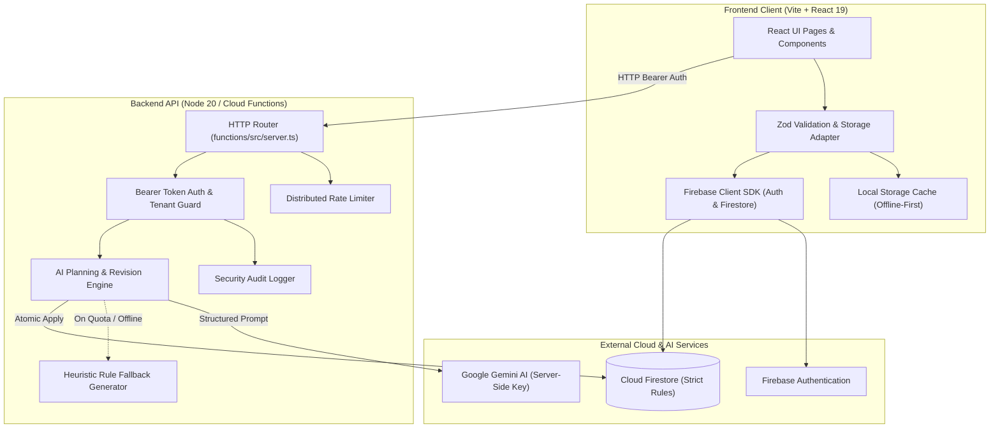

# Festora AI

<p align="center">
  
</p>

<p align="center">
  <strong>Plan smarter. Organize effortlessly. Celebrate beautifully.</strong>
</p>

<p align="center">
  A full-stack, GenAI-assisted event planning and celebration management platform for weddings, anniversaries, birthdays, community festivals, and social gatherings.
</p>

<p align="center">
  <a href="#project-overview">Overview</a> •
  <a href="#key-features">Key Features</a> •
  <a href="#architecture-overview">Architecture</a> •
  <a href="#technology-stack">Tech Stack</a> •
  <a href="#repository-structure">Repository Structure</a> •
  <a href="#prerequisites">Prerequisites</a> •
  <a href="#installation--local-development">Getting Started</a> •
  <a href="#environment-variables">Environment Variables</a> •
  <a href="#authentication--security">Security</a> •
  <a href="#api-reference">API Reference</a> •
  <a href="#testing--verification">Testing</a> •
  <a href="#cicd--deployment">Deployment</a> •
  <a href="#known-limitations--roadmap">Roadmap</a> •
  <a href="#contributing">Contributing</a>
</p>

---

## Project Overview

Planning memorable celebrations—such as weddings, milestone birthdays, cultural ceremonies, and community festivals—typically requires juggling fragmented spreadsheets, disparate vendor notes, fragile budgets, and shifting timelines.

**Festora AI** unifies the end-to-end planning lifecycle into a deterministic, user-controlled workspace powered by structured generative intelligence:

1. **Guided Intake**: An interactive event setup wizard captures celebration types, target dates, venues, estimated guest counts, budget constraints, and aesthetic themes.
2. **Structured AI Generation**: The backend invokes Google Gemini models through strict runtime Zod schemas to generate category-level budget allocations, milestone timelines, recommended tasks, and vendor checklists.
3. **Deterministic Financial Management**: Financial calculations, minor-unit currency math, actual spend tracking, and variance metrics are computed strictly in TypeScript code—preventing AI mathematical hallucinations.
4. **Safe Plan Revision Engine**: Users can iteratively refine and request AI revisions without risking their saved work. The revision engine guarantees that completed tasks, custom user tasks, and recorded expenses are strictly preserved across plan updates.
5. **Local-First with Cloud Sync**: Full functionality runs seamlessly in offline or local mode via browser storage, while syncing automatically to a hardened Firebase Firestore backend when signed in.

---

## Key Features

### 1. Implemented Features
- **Event Wizard & Setup**: Multi-step guided creation capturing celebration type, dates, guest counts, budget limits, city/country, and themes.
- **Structured AI Proposal Generation**: Generates cohesive celebration plans (category budgets, chronological milestones, curated tasks, vendor checklists) via Google Gemini with strict Zod schema validation.
- **Heuristic Offline Fallback**: If Gemini is unreachable or rate-limited, deterministic rule-based generators immediately provide valid plans without blocking the user.
- **Deterministic Budgeting & Expense Tracking**:
  - Stores all currency values in minor currency units (cents, paise) using integer arithmetic to eliminate floating-point rounding drift.
  - Real-time budgeted vs. actual spend variance tracking and progress visualizers.
- **Milestone Timelines & Task Management**:
  - Chronological milestones structured across 12-month, 6-month, 1-month, 1-week, and day-of-event horizons.
  - Priority levels (`low`, `medium`, `high`, `critical`), status tracking (`pending`, `in_progress`, `completed`, `cancelled`), and source tags (`user`, `ai`).
- **Plan Revision Safety Engine**:
  - User-added tasks and user-recorded expenses are strictly preserved when applying new or revised AI proposals.
  - Completed tasks are immutable across revisions.
- **Guest List & RSVP Tracking**: Guest management supporting invitation statuses, dietary constraints, plus-one tracking, and attendee counts.
- **Vendor Directory**: Categorized vendor tracking across Photography, Catering, Venue, Music/DJ, Decor, and Attire with contact info and notes.
- **Authentication & User Profiles**:
  - Firebase Authentication supporting Email/Password and Google Sign-In.
  - Per-user session state management with secure sign-out.
- **Security & Data Isolation**:
  - User-scoped Firestore database security rules (`users/{userId}/events/{eventId}`).
  - In-memory rate limiting and security audit logging.
  - Comprehensive Content Security Policy and security headers.

### 2. Partially Implemented Features
- **Collaborative Real-time Editing**: Events sync on mutation to Firestore, but concurrent multi-cursor real-time co-editing (CRDT/OT) is not yet supported.
- **Vendor Booking Workflow**: Vendor entries are managed as private user records; direct external booking and payment gateway checkouts are not integrated.

### 3. Planned Features
- [ ] Exportable PDF & Excel coordinator run sheets and vendor packets.
- [ ] Automated SMS/email RSVP reminders (Twilio/SendGrid integration).
- [ ] Calendar synchronization (Google Calendar, iCal, Outlook).
- [ ] Role-based access control for event co-hosts and planners.

---

## Visual Assets

Festora AI includes high-resolution visual assets and event photography located in the repository:

- **Official Brand Logo**: [`public/logo.png`](public/logo.png)
- **App Icons & Favicon**: [`public/favicon.svg`](public/favicon.svg), [`public/icons.svg`](public/icons.svg)
- **OpenGraph Social Preview**: [`public/og-image.svg`](public/og-image.svg)
- **Curated Celebration Photography**:
  - Wedding Décor: [`public/images/wedding_decor_stage.jpg`](public/images/wedding_decor_stage.jpg)
  - Birthday Celebrations: [`public/images/birthday_celebration_party.jpg`](public/images/birthday_celebration_party.jpg)
  - Community Festivals: [`public/images/community_cultural_event.jpg`](public/images/community_cultural_event.jpg)
  - College Fest Stage: [`public/images/college_fest_stage.jpg`](public/images/college_fest_stage.jpg)
  - Luxury Catering: [`public/images/luxury_catering_buffet.jpg`](public/images/luxury_catering_buffet.jpg)
  - Celebration Hero Banner: [`public/images/hero_celebration_banner.jpg`](public/images/hero_celebration_banner.jpg)

---

## Technology Stack

| Layer | Technology | Version | Purpose |
|---|---|---|---|
| **Frontend Framework** | React | `^19.3.1` | Declarative component UI |
| **Language** | TypeScript | `~6.0.3` (Frontend) / `^5.7.3` (Backend) | End-to-end type safety |
| **Bundler & Dev Server** | Vite | `^8.3.4` | Fast HMR and Rollup production builds |
| **Routing** | React Router | `^7.18.4` | Client-side SPA routing |
| **Animation & Motion** | Framer Motion | `^14.4.0` | Fluid page transitions and micro-interactions |
| **Icons & Visuals** | Lucide React | `^1.61.0` | Clean, modern iconography |
| **Data Visualization** | Recharts | `^3.10.1` | Budget allocation and variance charts |
| **Validation** | Zod | `^3.24.2` / `^4.6.7` | Runtime contract & AI output schema validation |
| **Backend Runtime** | Node.js / Firebase Functions | Node `20.x` / `^6.3.2` | Serverless backend API |
| **Database** | Cloud Firestore | Firebase `^13.0.0` / Admin `^13.1.0` | NoSQL document storage with security rules |
| **Authentication** | Firebase Authentication | `^13.0.0` | Identity management (Email & Google OAuth) |
| **AI Engine** | Google Gemini API (`@google/generative-ai`) | `^0.24.0` | Structured JSON event planning proposals |
| **Test Runner** | Vitest | `^5.0.5` | Fast unit, integration, and E2E test execution |
| **Hosting & CI/CD** | GitHub Actions, Vercel, Netlify | — | Automated test gates and SPA deployment |

---

## Architecture Overview



### Security Boundaries
- **Server-Side AI Secrets**: The `GEMINI_API_KEY` is strictly held on the server. Client applications never make direct calls to Gemini.
- **Tenant Isolation**: Cloud Functions verify that `event.ownerUid === decodedToken.uid`. Firestore rules enforce the same restriction at the database storage layer.
- **Deterministic Financial Invariants**: Budget calculations are isolated in purely deterministic functions to prevent floating-point inaccuracies or AI hallucinations.

---

## Repository Structure

```
Festora-AI/
├── .github/
│   └── workflows/
│       ├── ci.yml                     # Continuous integration, linting, type checks & tests
│       └── production-deploy.yml      # Tag/dispatch multi-target deployment workflow
├── functions/                         # Firebase Cloud Functions (Backend API)
│   ├── src/
│   │   ├── index.ts                   # Cloud Functions exports & emulator wiring
│   │   ├── server.ts                  # Standalone Express-compatible HTTP API server
│   │   ├── generate-event-plan.ts     # Initial AI proposal generation handler
│   │   ├── propose-plan-revision.ts   # Safe AI plan revision handler
│   │   ├── apply-event-plan.ts        # Atomic proposal persistence handler
│   │   ├── event-operations.ts        # CRUD operations for event documents
│   │   ├── schemas/                   # Shared Zod schemas (AI, request/response validation)
│   │   └── services/                  # Rate limiting, security logger, Gemini client
│   ├── package.json                   # Backend dependencies & scripts
│   └── tsconfig.json                  # Backend TypeScript configuration
├── public/                            # Static assets (logo, icons, sample photography)
├── src/                               # Frontend Application (React 19 + TypeScript)
│   ├── components/                    # Reusable UI components (Navbar, Footer, MetricCard)
│   ├── domain/                        # Domain models and business logic (budget math, rules)
│   ├── pages/                         # Route pages (Landing, Dashboard, Wizard, Settings)
│   │   └── event/                     # Event workspace (Overview, AI Assistant, Budget, Tasks, Vendors)
│   ├── services/                      # Firebase config, API client, local/cloud storage adapter
│   ├── types/                         # TypeScript interfaces and domain schemas
│   ├── App.tsx                        # React Router routes and layout structure
│   └── main.tsx                       # React application bootstrap
├── tests/                             # Vitest automated test suite (12 test suites, 70 tests)
│   ├── ai-schema.test.ts              # Zod AI proposal contract tests
│   ├── api-contracts.test.ts          # Backend REST contract verification
│   ├── authorization.test.ts          # Authentication and token guard tests
│   ├── backend-services.test.ts       # Rate limiting and security logger tests
│   ├── budget.test.ts                 # Minor-unit arithmetic and budget calculations
│   ├── database-persistence.test.ts   # Offline storage and Firestore adapter tests
│   ├── e2e-integration.test.ts        # End-to-end event lifecycle journey tests
│   ├── legal-auth.test.ts             # Auth workflow and legal page route tests
│   ├── performance.test.ts            # Sub-millisecond calculation benchmarks
│   ├── plan-revision-safety.test.ts   # User task/expense preservation tests
│   ├── security.test.ts               # Input sanitization and security boundary tests
│   └── task-rules.test.ts             # Task scheduling and priority rules
├── .env.example                       # Documented environment variable template
├── DEPLOYMENT.md                      # Production deployment guide
├── firestore.rules                    # Cloud Firestore security rules
├── firestore.indexes.json             # Composite index definitions
├── netlify.toml                       # Netlify build and SPA routing configuration
├── vercel.json                        # Vercel build and header configuration
├── vite.config.ts                     # Vite build configuration and manual chunking
└── package.json                       # Frontend dependencies, scripts, and overrides
```

---

## Prerequisites

Before setting up Festora AI, ensure you have the following installed:

- **Node.js**: `v20.x` LTS (verified compatibility)
- **npm**: `v10.x` or higher
- **Git**
- **Firebase CLI** (optional, for emulators and direct deployment):
  ```bash
  npm install -g firebase-tools
  ```
- **Google Gemini API Key** (optional for local development; heuristic fallback is used if omitted).

---

## Installation & Local Development

### 1. Clone the Repository
```bash
git clone https://github.com/AdityaP116/Festora-AI.git
cd Festora-AI
```

### 2. Install Dependencies
Install dependencies for both the frontend client and backend functions:
```bash
# Install frontend dependencies
npm ci

# Install backend functions dependencies
npm --prefix functions ci
```

### 3. Configure Environment Variables
Copy the example template to create your local `.env`:
```bash
cp .env.example .env
```
_Edit `.env` to configure your Firebase project credentials and optional Gemini API key. For initial UI evaluation, the default fallback values work out of the box._

### 4. Start Local Development Servers

Open two terminal sessions:

**Terminal 1 — Backend Functions Server (Port 5001):**
```bash
npm run server
```
_Compiles backend TypeScript and serves the HTTP API at `http://127.0.0.1:5001`._

**Terminal 2 — Frontend Application (Port 5173):**
```bash
npm run dev
```
_Starts Vite with Hot Module Replacement at `http://localhost:5173`._

Open your browser at `http://localhost:5173` to start using the application.

---

## Environment Variables

All supported variables are documented in [`.env.example`](.env.example).

> [!IMPORTANT]
> Variables prefixed with `VITE_` are bundled into the client-side JavaScript. **Never place private API keys (such as `GEMINI_API_KEY` or service account keys) into `VITE_` variables.**

### Backend Server & Functions Configuration (`functions/`)

| Variable | Used By | Required | Purpose | Safe Example Value |
|---|---|---|---|---|
| `PORT` | Backend Server | No | Local HTTP server port | `5001` |
| `GEMINI_API_KEY` | Backend Server / Functions | No | Server-side Gemini API key for structured AI planning | `AIzaSy...` (Private) |
| `FIREBASE_PROJECT_ID` | Backend Server / Functions | No | Firebase Admin project ID | `festora-ai` |

### Frontend Client Configuration (`src/`)

| Variable | Used By | Required | Purpose | Safe Example Value |
|---|---|---|---|---|
| `VITE_API_BASE_URL` | Frontend | No | Base URL of backend functions server | `http://127.0.0.1:5001` |
| `VITE_FIREBASE_API_KEY` | Frontend | Yes (Cloud Sync) | Firebase Web client API key | `AIzaSy...` (Public client key) |
| `VITE_FIREBASE_AUTH_DOMAIN` | Frontend | Yes (Cloud Sync) | Firebase Auth domain | `festora-ai.firebaseapp.com` |
| `VITE_FIREBASE_PROJECT_ID` | Frontend | Yes | Firebase project ID | `festora-ai` |
| `VITE_FIREBASE_STORAGE_BUCKET` | Frontend | No | Firebase Cloud Storage bucket | `festora-ai.firebasestorage.app` |
| `VITE_FIREBASE_MESSAGING_SENDER_ID` | Frontend | No | Cloud Messaging sender ID | `764953011093` |
| `VITE_FIREBASE_APP_ID` | Frontend | Yes | Firebase Web application ID | `1:764953011093:web:...` |
| `VITE_FIREBASE_MEASUREMENT_ID` | Frontend | No | Google Analytics measurement ID | `G-XXXXXXXXXX` |
| `VITE_USE_FIREBASE_EMULATOR` | Frontend | No | Route requests to local Firebase emulators | `false` |
| `VITE_FIREBASE_EMULATOR_HOST` | Frontend | No | Emulator host address | `127.0.0.1` |
| `VITE_FIREBASE_AUTH_PORT` | Frontend | No | Local Auth emulator port | `9099` |
| `VITE_FIREBASE_FIRESTORE_PORT` | Frontend | No | Local Firestore emulator port | `8080` |

---

## Authentication & Security

1. **Authentication Provider**: Managed via Firebase Authentication supporting email/password registration and Google OAuth sign-in.
2. **Backend Token Verification**: Protected endpoints verify incoming bearer tokens using `firebase-admin/auth`. Tokens lacking valid signatures or UIDs are rejected with `401 UNAUTHENTICATED`.
3. **Tenant Boundary Protection**: Every event document verifies that the authenticated UID matches the resource owner UID (`event.ownerUid === req.user.uid`). Cross-tenant modification attempts are rejected with `403 PERMISSION_DENIED`.
4. **Cloud Firestore Rules**: Enforced by [`firestore.rules`](firestore.rules). Collections under `users/{userId}/events/{eventId}` cannot be read or written by another user at the database level.
5. **Prompt Injection & AI Sanitization**: User inputs in the setup wizard and revision instructions are sanitized and wrapped in constrained system prompts. Model outputs must pass strict Zod parsing before being applied.
6. **Rate Limiting**: The backend employs an in-memory sliding window rate limiter (default: 60 requests per 15 minutes per IP/user) with security audit logging for anomalous request patterns.

---

## API Reference

The backend exposes an HTTP REST API defined in [`functions/src/server.ts`](functions/src/server.ts). All mutation and AI endpoints require a Bearer token header (`Authorization: Bearer <firebase_id_token>`).

### Endpoints

#### 1. `GET /health`
- **Auth**: None (Public)
- **Response** `200 OK`:
  ```json
  {
    "status": "healthy",
    "service": "festora-ai-backend",
    "version": "1.0.0",
    "timestamp": "2026-10-27T12:00:00.000Z"
  }
  ```

#### 2. `POST /generateEventPlan`
- **Auth**: Required (`Bearer <token>`)
- **Request Body**:
  ```json
  {
    "eventType": "wedding",
    "title": "Anita & Rohan's Wedding",
    "startDate": "2026-11-20",
    "location": { "city": "Mumbai", "country": "India" },
    "guestCount": 250,
    "budgetLimitMinor": 150000000,
    "currency": "INR",
    "theme": "Royal Traditional"
  }
  ```
- **Response** `200 OK`: Returns an `AIPlanProposal` object containing categories, milestone timelines, recommended tasks, and vendor checklists.

#### 3. `POST /applyEventPlan`
- **Auth**: Required (`Bearer <token>`)
- **Request Body**:
  ```json
  {
    "eventId": "evt_123456",
    "proposal": { /* AIPlanProposal */ }
  }
  ```
- **Response** `200 OK`:
  ```json
  {
    "success": true,
    "eventId": "evt_123456",
    "message": "Plan proposal successfully applied"
  }
  ```

#### 4. `POST /proposePlanRevision`
- **Auth**: Required (`Bearer <token>`)
- **Request Body**:
  ```json
  {
    "eventId": "evt_123456",
    "instruction": "Increase the photography budget and add drone shoot preparation tasks.",
    "currentPlan": { /* Current State */ }
  }
  ```
- **Response** `200 OK`: Returns the revised proposal while preserving completed tasks and user expenses.

#### 5. `GET /events` & `GET /events?eventId={id}`
- **Auth**: Required (`Bearer <token>`)
- **Response** `200 OK`: Returns array of user-owned events or the requested single event.

#### 6. `POST /events`
- **Auth**: Required (`Bearer <token>`)
- **Request Body**: Event initialization payload (`title`, `eventType`, `startDate`, `guestCount`, `budgetLimitMinor`, `location`).
- **Response** `200 OK`: Created event document.

#### 7. `DELETE /events?eventId={id}`
- **Auth**: Required (`Bearer <token>`)
- **Response** `200 OK`: Confirmation of event deletion.

---

## Testing & Verification

The repository includes a comprehensive, multi-layer automated test suite using **Vitest**. For details on the testing philosophy, pyramid layers, and benchmark targets, see [TEST_STRATEGY.md](docs/testing/TEST_STRATEGY.md) and historical reports in [docs/](docs/README.md).

```bash
# Run all automated tests (70 tests across 12 files)
npm test

# Run tests with test coverage reporting
npx vitest run --coverage

# Run TypeScript type check across frontend and backend
npx tsc -b
npm --prefix functions run build

# Run ESLint validation
npm run lint
```

### Verified Test Suites (100% Passing)

- [`tests/ai-schema.test.ts`](tests/ai-schema.test.ts): Zod schema constraints, boundary checking, and rejection of malformed AI proposals.
- [`tests/api-contracts.test.ts`](tests/api-contracts.test.ts): HTTP endpoint payloads, status codes, and error formatting.
- [`tests/authorization.test.ts`](tests/authorization.test.ts): Token authentication guards and cross-tenant boundary isolation.
- [`tests/backend-services.test.ts`](tests/backend-services.test.ts): Rate limiting, security logger, and error mapping.
- [`tests/budget.test.ts`](tests/budget.test.ts): Minor-unit integer math and budget variance tracking.
- [`tests/database-persistence.test.ts`](tests/database-persistence.test.ts): Offline caching and Firestore adapter sync.
- [`tests/e2e-integration.test.ts`](tests/e2e-integration.test.ts): Multi-journey end-to-end event lifecycles.
- [`tests/legal-auth.test.ts`](tests/legal-auth.test.ts): Authentication lifecycle and legal compliance page routing.
- [`tests/performance.test.ts`](tests/performance.test.ts): Sub-millisecond calculation benchmarks for budget and timeline engines.
- [`tests/plan-revision-safety.test.ts`](tests/plan-revision-safety.test.ts): Proof that completed tasks and user expenses are never lost during AI revisions.
- [`tests/security.test.ts`](tests/security.test.ts): XSS sanitization, prototype pollution defense, and payload size bounds.
- [`tests/task-rules.test.ts`](tests/task-rules.test.ts): Task scheduling, priority scoring, and dependency ordering.

---

## CI/CD & Deployment

Festora AI includes complete continuous integration and multi-target deployment workflows. For detailed deployment steps, refer to [DEPLOYMENT.md](DEPLOYMENT.md).

### 1. Continuous Integration ([`.github/workflows/ci.yml`](.github/workflows/ci.yml))
Triggered on all pushes to `main`, `master`, `develop` and on pull requests:
- **Stage 1**: Source validation, ESLint linting, and TypeScript compilation (`tsc -b`).
- **Stage 2**: Automated test execution (`npm test`).
- **Stage 3**: Production bundle compilation verification.

### 2. Production Deployment ([`.github/workflows/production-deploy.yml`](.github/workflows/production-deploy.yml))
Triggered on release tags (`v*.*.*`) or manual `workflow_dispatch`:
- **Pre-deployment Gates**: Full linting, type checks, and test suite verification.
- **Firebase Deployment**: Deploys Cloud Functions, Firestore security rules, and composite indexes.
- **Frontend Deployment**: Deploys client distribution bundle to Vercel or Netlify.

### 3. Frontend Hosting Configurations
- **Vercel**: Configured via [`vercel.json`](vercel.json) with SPA rewrites and strict security headers.
- **Netlify**: Configured via [`netlify.toml`](netlify.toml) with SPA redirects and secrets scanning filter rules.

---

## Privacy & Legal Information

Festora AI includes accessible client routes and user disclosures regarding data usage:
- **About**: [`src/pages/AboutPage.tsx`](src/pages/AboutPage.tsx) (Route: `/about`)
- **Terms & Conditions**: [`src/pages/TermsPage.tsx`](src/pages/TermsPage.tsx) (Route: `/terms`)
- **Privacy Policy**: [`src/pages/PrivacyPage.tsx`](src/pages/PrivacyPage.tsx) (Route: `/privacy`)

_Note: Privacy policies and legal pages provided in the application outline system data handling and user rights. They do not constitute formal legal certification under specific regional regulatory bodies._

---

## Known Limitations & Roadmap

### Current Scope & Limitations
- **No Direct Vendor Booking**: Vendor records serve as a curated directory; external payment and real-time vendor booking integrations are not supported.
- **Real-Time Multi-Cursor Collaboration**: Event updates are synchronized to Firestore on save/mutation; simultaneous real-time live typing/cursor synchronization is not yet implemented.

### Planned Improvements
- [ ] Exportable PDF & Excel coordinator run sheets and vendor packets.
- [ ] Automated SMS/email RSVP reminders (Twilio/SendGrid integration).
- [ ] Calendar synchronization (Google Calendar, iCal, Outlook).
- [ ] Role-based access control for event co-hosts and planners.

---

## Contributing

We welcome community contributions! Please review [CONTRIBUTING.md](CONTRIBUTING.md) for full instructions on our code of conduct, branch conventions, and testing requirements.

1. Fork the repository.
2. Create a feature branch (`git checkout -b feature/amazing-feature`).
3. Commit your changes (`git commit -m "feat: add amazing feature"`).
4. Verify tests and linting (`npm test && npm run lint`).
5. Open a Pull Request.

---

## Security Reporting

Please review our [Security Policy](SECURITY.md) for information on reporting security vulnerabilities.

---

## License

This repository does not currently include a public open-source license file. All rights are reserved by the project owner. To request licensing clarification or commercial use, please contact the repository owner.

---

<p align="center">
  Built with ❤️ for memorable celebrations.
</p>
