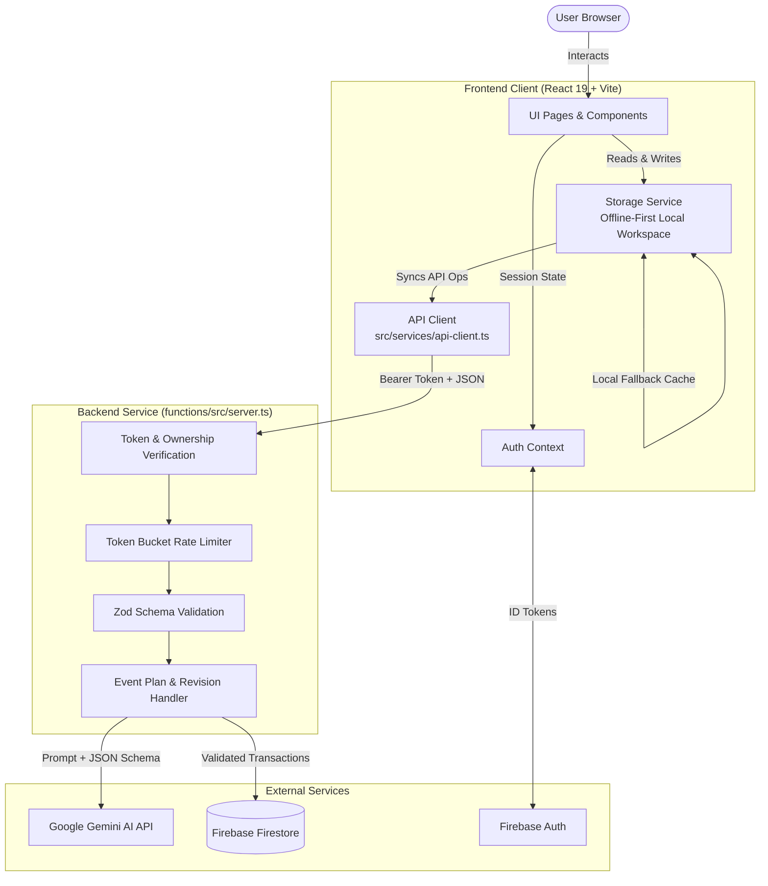

# Festora AI

<p align="center">
  
</p>

<p align="center">
  <strong>Plan smarter. Organize effortlessly. Celebrate beautifully.</strong>
</p>

<p align="center">
  A full-stack, GenAI-assisted event planning and celebration management platform for weddings, anniversaries, birthdays, community festivals, and social gatherings.
</p>

<p align="center">
  <a href="#overview">Overview</a> •
  <a href="#key-features">Key Features</a> •
  <a href="#architecture">Architecture</a> •
  <a href="#technology-stack">Tech Stack</a> •
  <a href="#repository-structure">Repository Structure</a> •
  <a href="#local-development">Getting Started</a> •
  <a href="#api-reference">API Reference</a> •
  <a href="#testing--code-quality">Testing</a> •
  <a href="#security--data-persistence">Security</a> •
  <a href="#license">License</a>
</p>

---

## Overview

Organizing meaningful celebrations—such as weddings, milestone birthdays, cultural ceremonies, and community festivals—typically requires juggling multiple spreadsheets, disparate vendor contacts, fragile budgets, and shifting timelines.

**Festora AI** unifies the planning lifecycle into an intuitive, deterministic workspace paired with structured generative intelligence:

1. **Guided Intake**: An interactive event setup wizard captures celebration types, target dates, venues, estimated guest counts, budget constraints, and aesthetic themes.
2. **Structured AI Generation**: The backend invokes Google Gemini models through strict Zod schemas to generate category-level budget allocations, milestone timelines, recommended tasks, and vendor checklists.
3. **Deterministic Financial Management**: Financial calculations, minor-unit currency math, actual spend tracking, and variance metrics are computed strictly in TypeScript code—preventing AI mathematical hallucinations.
4. **Safe Plan Revision Engine**: Users can iteratively refine and request AI revisions without risking their saved work. The revision engine guarantees that completed tasks, custom user tasks, and recorded expenses are strictly preserved across plan updates.
5. **Local-First with Cloud Sync**: Full functionality runs seamlessly in offline or local mode via browser storage, while syncing automatically to a hardened Firebase Firestore backend when signed in.

---

## Key Features

### 1. AI-Assisted Event Planning & Proposal Generation

- **Tailored Proposals**: Generates cohesive celebration plans tailored to specific event types (e.g., weddings, birthdays, anniversaries, community festivals).
- **Strict Structured Schemas**: All AI responses are validated against runtime Zod schemas before being presented to the user.
- **Graceful Fallback Logic**: If the AI model is temporarily unreachable or exhausts rate quotas, deterministic heuristic fallback plans ensure users are never blocked.

### 2. Deterministic Budgeting & Expense Tracking

- **Minor-Unit Accuracy**: Stores all currency values in minor currency units (e.g., cents, paise) using integer arithmetic to eliminate floating-point rounding errors.
- **Real-Time Variance Analysis**: Computes budgeted vs. actual expenditures per category with percentage breakdown and visual warnings when exceeding allocations.
- **Preserved Records**: User-recorded transactions are immutable against automated AI plan updates.

### 3. Milestone Timelines & Task Management

- **Chronological Milestones**: Automatically structures preparation schedules across 12-month, 6-month, 1-month, 1-week, and day-of-event horizons.
- **Priority & Phase Categorization**: Categorizes tasks by urgency (`HIGH`, `MEDIUM`, `LOW`) and logistical phase (`PLANNING`, `BOOKING`, `EXECUTION`, `WRAP_UP`).
- **Interactive Checklists**: Filter tasks by status, phase, and due date with instant status toggles.

### 4. Vendor Management & Directory

- **Category Organization**: Track prospective and booked vendors across standard event categories (Catering, Venue, Photography, Music, Decor).
- **Payment & Contract Tracking**: Record quotation amounts, contact details, notes, and deposit status.
- **Transparency Safeguards**: Clearly separates user-entered directory records from automated suggestions—Festora AI does not claim unverified vendor quotes or make unauthorized bookings.

### 5. Guest List & RSVP Tracking

- **Guest Book**: Track invitees, party sizes, dietary restrictions, RSVP confirmations, and assigned seating.
- **Attendance Aggregates**: Real-time counters for confirmed, declined, and pending RSVPs.

### 6. Multi-Tenant Workspace & Security

- **Firebase Authentication**: Email/password authentication, guest/demo host exploration mode, and secure session management.
- **Cross-Tenant Isolation**: Server-enforced authorization verifying that users can only inspect, create, modify, or delete events belonging to their verified UID.
- **Audit Logging & Rate Limiting**: In-memory token bucket rate limiting on backend endpoints and security event logging for unauthenticated attempts.

---

## Technology Stack

The stack has been audited and verified from [`package.json`](package.json) and [`functions/package.json`](functions/package.json):

| Layer                    | Technology                                     | Version                                     | Purpose                                                                  |
| ------------------------ | ---------------------------------------------- | ------------------------------------------- | ------------------------------------------------------------------------ |
| **Frontend Framework**   | React                                          | `^19.3.1`                                   | Declarative UI layer with modern concurrent features                     |
| **Language**             | TypeScript                                     | `~6.0.3` (client) / `^5.7.3` (server)       | End-to-end static typing across contracts, schema, and UI                |
| **Bundler & Dev Server** | Vite                                           | `^8.3.4`                                    | Fast HMR dev server and optimized production Rollup builds               |
| **Routing**              | React Router DOM                               | `^7.18.4`                                   | Client-side routing, protected auth routes, and workspace sub-navigation |
| **State & Persistence**  | Context API & Storage Service                  | Custom                                      | Offline-first local state synchronized with remote Firebase Firestore    |
| **Data Validation**      | Zod                                            | `^4.6.7` (frontend) / `^3.24.2` (functions) | Strict runtime schema parsing for API payloads, AI inputs, and outputs   |
| **Backend Functions**    | Node.js HTTP Server / Cloud Functions          | Node 20 / `firebase-functions ^6.3.2`       | Local Node.js development server & scalable Firebase Cloud Functions     |
| **Admin SDK**            | Firebase Admin                                 | `^13.1.0`                                   | Privileged server-side Firestore operations and token verification       |
| **Client SDK**           | Firebase Web SDK                               | `^13.0.0`                                   | Client authentication and live database connections                      |
| **AI Provider**          | Google Generative AI (`@google/generative-ai`) | `^0.24.0`                                   | Google Gemini 2.5 Flash / Flash Lite model structured generation         |
| **Icons & Design**       | Lucide React                                   | `^1.61.0`                                   | Accessible and consistent SVG iconography                                |
| **Animation**            | Framer Motion                                  | `^14.4.0`                                   | Smooth UI transitions, modal displays, and page switches                 |
| **Date Utilities**       | Date-fns                                       | `^4.4.0`                                    | Date formatting and timeline calculation                                 |
| **Testing**              | Vitest                                         | `^5.0.5`                                    | Fast unit, integration, and security test runner                         |
| **Linter**               | ESLint                                         | `^10.13.0`                                  | Code quality and style enforcement                                       |

---

## Architecture

Festora AI employs a hybrid **local-first + cloud-synchronized architecture**:



### Data Flow Principles

1. **Deterministic Calculation**: Business logic (budgets, sums, task deadlines, revisions) is handled entirely by compiled TypeScript code.
2. **AI Boundary**: Generative models are treated as untrusted external advisors. Output is parsed through strict Zod schemas before entering the state tree.
3. **Defense in Depth**: Client routes perform UX-level auth redirection, while Cloud Functions enforce server-side Firebase token authentication and UID tenant matching. Firestore rules (`firestore.rules`) enforce document-level ownership constraints.

---

## Repository Structure

```
Festora-AI/
├── .env.example                  # Template of required client & server environment variables
├── firebase.json                 # Firebase configuration (Hosting, Functions, Emulators)
├── firestore.rules               # Firestore security rules enforcing tenant isolation
├── firestore.indexes.json        # Composite indexes for event queries
├── package.json                  # Root npm configuration (frontend dependencies & scripts)
├── tsconfig.json                 # TypeScript compiler configuration
├── vite.config.ts                # Vite bundler configuration
│
├── functions/                    # Backend Node.js / Cloud Functions codebase
│   ├── package.json              # Backend dependencies (firebase-admin, gemini SDK, zod)
│   ├── tsconfig.json             # Backend TypeScript configuration
│   └── src/
│       ├── index.ts              # Firebase Cloud Functions entry point
│       ├── server.ts             # Local standalone HTTP dev server (Port 5001)
│       ├── event-operations.ts   # CRUD handlers for user celebration events
│       ├── generate-event-plan.ts# AI plan proposal generator endpoint
│       ├── apply-event-plan.ts   # Atomically applies AI proposal to Firestore
│       ├── propose-plan-revision.ts # Safe plan revision generator
│       ├── schemas/              # Zod validation schemas for AI input/output
│       └── services/             # Auth verification, rate limiter, security logger
│
├── public/                       # Static public assets (manifest.json, logo.png, icons)
│   ├── logo.png                  # Official Festora AI logo
│   └── manifest.json             # Progressive Web App manifest
│
├── src/                          # Frontend React application source
│   ├── main.tsx                  # Application bootstrap & DOM root render
│   ├── App.tsx                   # Top-level router and layout shell
│   ├── assets/                   # Bundled UI assets
│   ├── components/               # Reusable UI component library
│   │   ├── common/               # Modals, form controls, badges, buttons
│   │   ├── layout/               # Navbar, Footer, AppLayout (sidebar & mobile header)
│   │   ├── seo/                  # SeoHead meta tags & open graph manager
│   │   └── ui/                   # EmptyState, ErrorBoundary, MetricCard
│   ├── domain/                   # Shared validation rules, budget math & AI schemas
│   ├── pages/                    # Route-level view components
│   │   ├── LandingPage.tsx       # Marketing & value proposition page
│   │   ├── LoginPage.tsx         # User authentication sign-in
│   │   ├── RegisterPage.tsx      # User account registration
│   │   ├── DashboardPage.tsx     # Celebration overview workspace
│   │   ├── EventWizardPage.tsx   # Multi-step celebration onboarding wizard
│   │   ├── SettingsPage.tsx      # Account settings & workspace preferences
│   │   └── event/                # Single-event management views
│   │       ├── AIAssistantPage.tsx # Interactive AI advisor & revision request
│   │       ├── BudgetPage.tsx      # Category allocations & actual expense tracker
│   │       ├── EventOverviewPage.tsx # Master event dashboard & health status
│   │       ├── GuestsPage.tsx      # Guest list, RSVP stats & seating
│   │       ├── TasksPage.tsx       # Task checklist by phase and priority
│   │       ├── TimelinePage.tsx    # Chronological run-of-show schedule
│   │       └── VendorsPage.tsx     # Vendor directory & quotation tracker
│   ├── services/                 # Frontend client service singletons
│   │   ├── api-client.ts         # Authenticated HTTP client with retry logic
│   │   ├── auth-context.tsx      # Authentication state and provider
│   │   ├── firebase.ts           # Firebase SDK initialization
│   │   └── storage.ts            # Local-first storage adapter with cloud sync
│   ├── styles/                   # Global CSS tokens, resets & responsive layout
│   └── types/                    # Core TypeScript definitions (Events, Tasks, Budgets)
│
└── tests/                        # Automated Vitest test suite
    ├── ai-schema.test.ts         # Zod schema validation tests
    ├── api-contracts.test.ts     # Backend API schema & payload tests
    ├── authorization.test.ts     # Token verification & ownership tests
    ├── backend-services.test.ts  # Cloud functions business logic tests
    ├── budget.test.ts            # Deterministic integer arithmetic tests
    ├── database-persistence.test.ts # Storage adapter & persistence tests
    ├── e2e-integration.test.ts   # End-to-end integration journeys
    ├── performance.test.ts       # Benchmark tests on calculations
    ├── plan-revision-safety.test.ts # User-edit preservation tests
    ├── security.test.ts          # Input sanitization & security tests
    └── task-rules.test.ts        # Task lifecycle & invariant tests
```

---

## Prerequisites

Before running Festora AI locally, verify you have installed:

- **Node.js**: `v20.x` or later (Node 20 is required by the Cloud Functions environment).
- **npm**: `v10.x` or later.
- **Google Gemini API Key** _(Optional for basic local dev; fallback mode is active if omitted)_: Obtainable from [Google AI Studio](https://aistudio.google.com/).
- **Firebase CLI** _(Optional, needed if running emulators or deploying)_: `npm install -g firebase-tools`.

---

## Local Development

### 1. Clone the Repository

```bash
git clone https://github.com/AdityaP116/Festora-AI.git
cd Festora-AI
```

### 2. Install Dependencies

Install dependencies for both the frontend and backend:

```bash
# Install frontend dependencies
npm install

# Install backend functions dependencies
npm --prefix functions install
```

### 3. Configure Environment Variables

Copy `.env.example` to `.env` in the repository root:

```bash
cp .env.example .env
```

Review `.env` and fill in your credentials. For basic local frontend evaluation, the default fallback values work out of the box.

### 4. Start the Development Servers

Open two separate terminals:

**Terminal 1 — Backend Functions Server (Port 5001):**

```bash
npm run server
```

_Compiles the backend TypeScript and starts the local HTTP API server at `http://127.0.0.1:5001`._

**Terminal 2 — Frontend Application (Port 5173):**

```bash
npm run dev
```

_Starts the Vite dev server with instant Hot Module Replacement (HMR) at `http://localhost:5173`._

Open your browser and navigate to:

```
http://localhost:5173
```

---

## Environment Variables

All supported environment variables are centralized in [`.env.example`](.env.example):

### Server-Side Variables (`functions/` & Local Backend Server)

_These must remain private and must never be committed to source control or exposed in frontend bundles._

| Variable              | Description                                      | Required                          | Default      |
| --------------------- | ------------------------------------------------ | --------------------------------- | ------------ |
| `PORT`                | Local backend HTTP server port                   | No                                | `5001`       |
| `GEMINI_API_KEY`      | Google Gemini API key for structured AI planning | No _(Fallback used if omitted)_   | —            |
| `FIREBASE_PROJECT_ID` | Target Firebase Project identifier for Admin SDK | No _(Defaults to project config)_ | `festora-ai` |

### Client-Side Variables (Vite Frontend Bundle)

_These public configuration keys are embedded into the client bundle at build time._

| Variable                            | Description                                      | Required             | Default                          |
| ----------------------------------- | ------------------------------------------------ | -------------------- | -------------------------------- |
| `VITE_API_BASE_URL`                 | Base URL for the Festora AI backend API          | No                   | `http://127.0.0.1:5001`          |
| `VITE_FIREBASE_API_KEY`             | Firebase Web API Key                             | Yes (for cloud sync) | Configured in `.env`             |
| `VITE_FIREBASE_AUTH_DOMAIN`         | Firebase Authentication domain                   | Yes (for cloud sync) | `festora-ai.firebaseapp.com`     |
| `VITE_FIREBASE_PROJECT_ID`          | Firebase Project ID                              | Yes                  | `festora-ai`                     |
| `VITE_FIREBASE_STORAGE_BUCKET`      | Firebase Storage bucket                          | No                   | `festora-ai.firebasestorage.app` |
| `VITE_FIREBASE_MESSAGING_SENDER_ID` | Firebase Cloud Messaging Sender ID               | No                   | `764953011093`                   |
| `VITE_FIREBASE_APP_ID`              | Firebase Web App ID                              | Yes                  | Configured in `.env`             |
| `VITE_FIREBASE_MEASUREMENT_ID`      | Optional Google Analytics Measurement ID         | No                   | `G-7VFRDDDZXB`                   |
| `VITE_USE_FIREBASE_EMULATOR`        | Route client traffic to local Firebase Emulators | No                   | `false`                          |
| `VITE_FIREBASE_EMULATOR_HOST`       | Local emulator host address                      | No                   | `127.0.0.1`                      |
| `VITE_FIREBASE_AUTH_PORT`           | Local Auth emulator port                         | No                   | `9099`                           |
| `VITE_FIREBASE_FIRESTORE_PORT`      | Local Firestore emulator port                    | No                   | `8080`                           |

---

## API Reference

The backend exposes a standard REST HTTP interface defined in [`functions/src/server.ts`](functions/src/server.ts). All mutation and AI endpoints require a valid Firebase ID token passed in the `Authorization: Bearer <token>` header.

### Endpoints

#### 1. `GET /health`

- **Description**: Returns health status and version metadata.
- **Auth**: None (Public).
- **Response**:
  ```json
  {
    "status": "healthy",
    "service": "festora-ai-backend",
    "version": "1.0.0",
    "timestamp": "2026-10-26T17:30:00.000Z"
  }
  ```

#### 2. `POST /generateEventPlan`

- **Description**: Generates an initial structured AI proposal (budget, tasks, timeline) based on event setup parameters.
- **Auth**: Required (`Bearer <token>`).
- **Request Body**:
  ```json
  {
    "eventType": "wedding",
    "title": "Anita & Rohan's Wedding",
    "startDate": "2026-11-20",
    "location": { "city": "Mumbai", "country": "India" },
    "guestCount": 250,
    "budgetLimitMinor": 150000000,
    "currency": "INR",
    "theme": "Royal Traditional"
  }
  ```
- **Response**: Full structured AI proposal adhering to `aiPlanProposalSchema`.

#### 3. `POST /applyEventPlan`

- **Description**: Atomically applies an approved AI proposal to Firestore while preserving existing user data.
- **Auth**: Required (`Bearer <token>`).
- **Request Body**:
  ```json
  {
    "eventId": "evt_abc123",
    "proposal": {
      /* AI Proposal Object */
    }
  }
  ```

#### 4. `POST /proposePlanRevision`

- **Description**: Requests an AI revision based on user feedback while enforcing invariant rules to preserve user-modified records.
- **Auth**: Required (`Bearer <token>`).
- **Request Body**:
  ```json
  {
    "eventId": "evt_abc123",
    "instruction": "Increase the photography budget by 20% and add pre-wedding shoot tasks.",
    "currentPlan": {
      /* Current State */
    }
  }
  ```

#### 5. `GET /events` & `GET /events?eventId={id}`

- **Description**: Retrieves all celebration events owned by the authenticated user, or a single event by ID.
- **Auth**: Required (`Bearer <token>`).

#### 6. `POST /events`

- **Description**: Creates a new celebration event document under the authenticated user's scope.
- **Auth**: Required (`Bearer <token>`).

#### 7. `DELETE /events?eventId={id}`

- **Description**: Deletes a celebration event and associated sub-collections.
- **Auth**: Required (`Bearer <token>`).

---

## Testing & Code Quality

The repository includes a comprehensive, multi-layer automated test suite executed with Vitest:

```bash
# Run all automated tests
npm test

# Run tests with test coverage reporting
npx vitest run --coverage

# Run TypeScript compile validation across both projects
npm run build

# Run ESLint validation
npm run lint
```

### Verified Test Results

Running `npm test` executes **11 test suites** comprising **65 tests**, with a 100% pass rate:

- `tests/ai-schema.test.ts`: Validates Zod schema constraints, boundary cases, and invalid AI payload rejections.
- `tests/api-contracts.test.ts`: Asserts payload shapes and status codes across all HTTP endpoints.
- `tests/authorization.test.ts`: Verifies token authentication and cross-tenant boundary protections.
- `tests/backend-services.test.ts`: Tests backend rate limiter, security logger, and error mapping.
- `tests/budget.test.ts`: Tests minor-unit integer arithmetic and variance tracking.
- `tests/database-persistence.test.ts`: Verifies offline fallback caching and Firestore adapter sync.
- `tests/e2e-integration.test.ts`: Tests end-to-end event lifecycles across creation, AI planning, and revisions.
- `tests/performance.test.ts`: Verifies sub-millisecond calculation benchmarks for budgets and timelines.
- `tests/plan-revision-safety.test.ts`: Proves completed tasks and user-added expenses are never overwritten during AI revisions.
- `tests/security.test.ts`: Tests XSS sanitization, prototype pollution protection, and payload size bounds.
- `tests/task-rules.test.ts`: Tests lifecycle states, urgency scoring, and dependency ordering.

---

## Security & Data Persistence

### 1. Data Ownership & Tenant Isolation

- **Authentication**: Powered by Firebase Authentication. User identity is extracted from cryptographically verified ID tokens (`req.headers.authorization`).
- **Backend Authorization**: Endpoints verify that `event.ownerId === caller.uid` before performing read, update, or delete operations.
- **Firestore Rules**: [`firestore.rules`](firestore.rules) guarantees that documents in the `events`, `tasks`, `budget_items`, and `guests` collections are inaccessible to unauthorized callers.

### 2. Prompt Injection & AI Safety

- Prompts passed to Google Gemini are encapsulated within strictly constrained system instructions with structured JSON schema output mandates.
- All model responses are validated using Zod; malformed outputs trigger automatic sanitization or fallbacks rather than executing raw model output.

### 3. Financial Invariants

- Budgets and expenses are stored as integers representing minor currency units (cents, pence, paise).
- Floating-point arithmetic is explicitly forbidden in balance calculations to eliminate cumulative rounding drift.

---

## Deployment

### Frontend (Firebase Hosting)

Build the production-optimized client bundle:

```bash
npm run build
```

Deploy the distribution artifacts to Firebase Hosting:

```bash
firebase deploy --only hosting
```

### Backend (Firebase Cloud Functions)

Deploy the serverless Cloud Functions:

```bash
firebase deploy --only functions
```

### Security Rules & Indexes

Deploy Firestore security rules and composite indexes:

```bash
firebase deploy --only firestore:rules,firestore:indexes
```

---

## Known Limitations & Roadmap

### Current Scope & Limitations

- **Vendor Marketplace**: Vendor records are stored as user-entered private directories. Festora AI does not execute direct live vendor bookings or provide real-time payment gateway transactions.
- **Collaborative Real-time Editing**: While data syncs to Firestore on mutation, concurrent multi-user live cursors (operational transformation / CRDT) are not yet implemented.
- **Browser E2E Suite**: The test suite covers comprehensive integration, contract, and unit tests using Node/JSDOM environments; Playwright/Cypress end-to-end browser execution is planned.

### Roadmap

- [ ] Multi-user collaboration with role-based access control (Host, Co-planner, Guest).
- [ ] PDF & spreadsheet export for day-of coordination packets and vendor itineraries.
- [ ] Automated email/SMS RSVP reminders via Twilio or SendGrid integrations.
- [ ] Calendar sync (Google Calendar, Apple iCal, Microsoft Outlook) for milestone schedules.
- [ ] End-to-end browser regression suite with Playwright.

---

## Contributing

Contributions, bug reports, and feature requests are welcome!

1. **Fork** the repository on GitHub.
2. **Create a branch** for your feature:
   ```bash
   git checkout -b feature/amazing-feature
   ```
3. **Commit your changes**:
   ```bash
   git commit -m "feat: add amazing feature"
   ```
4. **Run tests** and verify everything passes:
   ```bash
   npm test && npm run build
   ```
5. **Push to GitHub**:
   ```bash
   git push origin feature/amazing-feature
   ```
6. **Open a Pull Request** describing your changes.

---

## License

This project does not currently declare an open-source license file in the repository root. All rights are reserved by the repository owner. If you intend to use or distribute this software, please open an issue to request licensing clarification.

---

<p align="center">
  Built with ❤️ for memorable celebrations.
</p>
